# 서산 여유 산책 1박 2일

우쭈쭈님을 위한 여유 · 산책 코스, 숙소는 서라온 수림3

11/28(토) ~ 11/29(일) · 서초 집 출발 · 자동차 이동 · 목표는 느긋하게 1만 보

<Timeline color="ai" center>
<li class="now"><b>토 07:30</b>서초 집 출발</li>
<li><b>01</b>해미읍성 성곽 산책</li>
<li><b>02</b>읍성뚝배기 점심</li>
<li><b>03</b>개심사 솔숲길</li>
<li><b>04</b>동부시장 야식 장보기</li>
<li><b>🏡 숙박</b>서라온 수림3 석식 · 야경</li>
<li><b>05</b>진국집 게국지 점심</li>
<li><b>귀가</b>서초 집</li>
</Timeline>

---
part: 3
eyebrow: route · 가는 길 165km · 오는 길 125km
---

# 집에서 **서산까지**, 이동 약도

가는 길은 경부 · 평택제천으로 돌아서 느긋하게, 오는 길은 서해안고속도로로 곧장

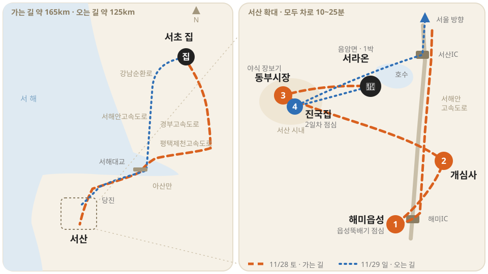

1일차 · 토 11/28 · 07:30 출발

<b>집 → 1</b> 경부 → 평택제천 → 서해안고속도로 · 165km · 2시간 20분 + ☕ 여유 40분 → 10:30 해미읍성

<b>1 → 2</b> 해미읍성 → 개심사 · 9km · 17분

<b>2 → 3</b> 개심사 → 동부시장 · 16km · 24분

<b>3 → 🏡</b> 동부시장 → 서라온 · 7km · 11분

2일차 · 일 11/29 · 12:40 귀가 출발

<b>🏡 → 4</b> 서라온 → 진국집 · 8km · 11분

<b>4 → 집</b> 서산IC → 서해안고속도로 → 강남순환로 · 125km · 1시간 55분 + ☕ 여유 1시간 → 15:40 집

☕ 가는 길 휴게소 · 경부 → 평택제천 → 서해안
<Timeline color="ai">
<li><b>07:30</b>서초 집</li>
<li><b>5km</b>만남의광장 6분</li>
<li><b>32km</b>기흥 26분</li>
<li><b>59km</b>안성 47분</li>
<li><b>95km</b>평택복합 1시간 20분</li>
<li><b>127km</b>행담도 1시간 55분</li>
<li><b>162km</b>서산 2시간 20분</li>
<li><b>165km</b>해미읍성</li>
</Timeline>

☕ 오는 길 휴게소 · 서해안 서울 방향
<Timeline color="py">
<li><b>12:40</b>진국집</li>
<li><b>42km</b>행담도 40분</li>
<li><b>70km</b>화성 1시간 5분</li>
<li><b>84km</b>매송 1시간 15분</li>
<li><b>125km</b>서초 집</li>
</Timeline>

---
class: tight
part: 2
eyebrow: schedule · 11/28 토 ~ 11/29 일
---

# 일정 **한눈에** — 토요일은 걷고, 일요일은 쉬엄쉬엄

1일차 · 토 11/28

<Timeline color="py">
<li class="now"><b>07:30</b>서초 집 출발 ☕ 휴게소 쉬기</li>
<li><b>10:30</b>해미읍성 성곽 산책 80분</li>
<li><b>11:50</b>읍성뚝배기 소머리곰탕</li>
<li><b>13:10</b>개심사 솔숲길 80분</li>
<li><b>14:55</b>동부시장 야식 장보기</li>
<li><b>15:30</b>서라온 체크인 둘레길 · 노을</li>
<li><b>18:00</b>담소정 석식 스키야키 · 초밥</li>
<li><b>19:30</b>야경 촬영 불멍 · 야식</li>
</Timeline>

2일차 · 일 11/29

<Timeline color="ai">
<li><b>07:30</b>일어나기 일출 약 07:26</li>
<li><b>08:00</b>유카타 아침 촬영 대나무숲 · 정원</li>
<li><b>09:30</b>티룸에서 차 한 잔 짐 정리</li>
<li><b>10:50</b>체크아웃 퇴실 11시</li>
<li><b>11:10</b>진국집 점심 게국지 백반</li>
<li class="now"><b>12:40</b>귀가 출발 ☕ 휴게소 쉬기</li>
<li><b>15:40</b>서초 집 도착</li>
</Timeline>

<Grid cols="3" gap="12" class="mt-3">
<Tile kind="soft" color="ok" tag="👣 1일차 걸음" title="약 9천 보">해미읍성 4천 · 개심사 2천5백 · 시장 1천 · 둘레길 1천5백</Tile>
<Tile kind="soft" color="ai" tag="👣 2일차 걸음" title="약 3천 보">아침 둘레길 · 촬영 산책</Tile>
<Tile kind="soft" color="warn" tag="🌡️ 11월 말 서산" title="아침 0℃ 안팎 · 낮 10℃ 안팎">일몰 약 17:16 · 겉옷 · 장갑 챙기기</Tile>
</Grid>

---
layout: magazine
class: tight
---

# 01 · 해미읍성

조선 읍성의 모습이 가장 잘 남은 성. 잔디밭과 성곽길이 넓어 공원처럼 걷기 좋아요.

<Chip color="ai">내비 검색</Chip> 해미읍성 · <Chip kind="fill">주소</Chip> 서산시 해미면 남문2로 143

<Tile kind="fill" color="yellow" tag="🚶 오늘의 산책" title="진남문으로 들어가 성곽을 따라 한 바퀴">성곽 길이 약 1.5km, 높이 5m. 성 안의 동헌 · 객사 · 옥사 · 회화나무도 천천히</Tile>

<Grid cols="3" gap="12">
<Tile kind="soft" color="ok" tag="입장 · 주차" title="모두 무료">관람 06:00~19:00</Tile>
<Tile kind="soft" color="py" tag="머무는 시간" title="약 80분">평지라 부담 없는 워밍업</Tile>
<Tile kind="soft" color="py" tag="다음" title="읍성뚝배기">남문 앞 골목, 걸어서 3분</Tile>
</Grid>

::right::

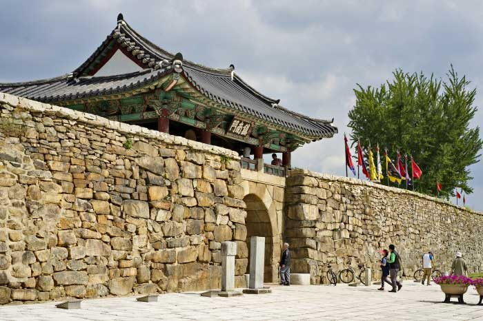

정문 진남문과 성곽 · 사진 한국관광공사

---
layout: magazine
class: tight
---

# 02 · 점심 — 읍성뚝배기

해미읍성 앞 곰탕집. 진한 소머리곰탕 한 그릇으로 몸을 데워요.

<Chip color="ai">내비 검색</Chip> 읍성뚝배기 · <Chip kind="fill">주소</Chip> 서산시 해미면 읍성마을1길 7-7

<Tile kind="fill" color="yellow" tag="🍲 고른 이유" title="고기가 넉넉한 진한 국물">잡내 없이 깔끔하다는 후기가 많고, 김치 · 깍두기 평도 좋아요</Tile>

<Grid cols="3" gap="12">
<Tile kind="soft" color="ok" tag="대표 메뉴" title="소머리곰탕 14,000원">사골설렁탕 12,000원</Tile>
<Tile kind="soft" color="py" tag="곁들임" title="소머리수육 소 50,000원">대 60,000원 · 둘이면 곰탕만으로 충분</Tile>
<Tile kind="soft" color="warn" tag="영업" title="09:00~19:00 · 화요일 휴무">점심엔 대기 있음 → 12시 전에 입장</Tile>
</Grid>

<Core>주차는 해미읍성 공영주차장(무료)에 그대로 두고 걸어가요.</Core>

::right::

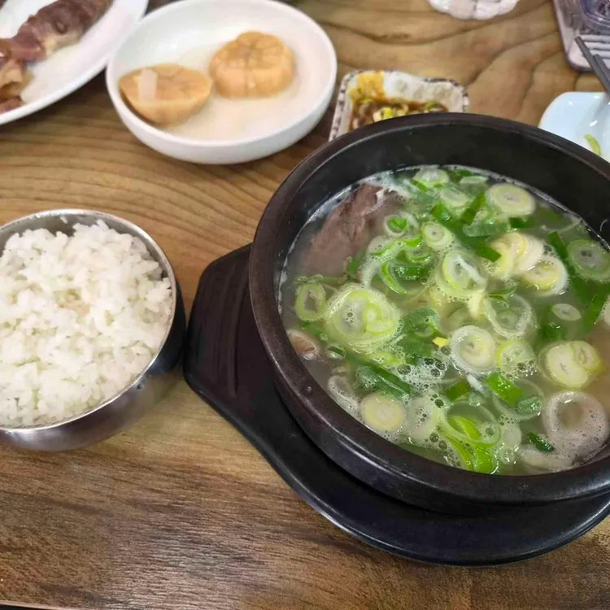

소머리곰탕 상차림 · 사진 다이닝코드

---
layout: magazine
class: tight
---

# 03 · 개심사

'마음을 여는 절'. 솔숲길을 10분쯤 오르면 연못과 외나무다리, 휜 기둥의 절집이 나와요.

<Chip color="ai">내비 검색</Chip> 개심사 · <Chip kind="fill">주소</Chip> 서산시 운산면 개심사로 321-86

<Tile kind="fill" color="yellow" tag="🌲 오늘의 산책" title="일주문 → 솔숲 돌계단 → 연못 외나무다리">자연목을 그대로 쓴 범종각 · 심검당 기둥이 볼거리. 경내를 천천히 한 바퀴</Tile>

<Grid cols="3" gap="12">
<Tile kind="soft" color="ok" tag="입장 · 주차" title="입장 무료 · 절 아래 주차장">주차 요금은 현장 확인</Tile>
<Tile kind="soft" color="warn" tag="길" title="오르막 · 돌계단">편한 운동화 필수</Tile>
<Tile kind="soft" color="py" tag="다음" title="동부시장 24분">시내로 내려가 장보기</Tile>
</Grid>

::right::

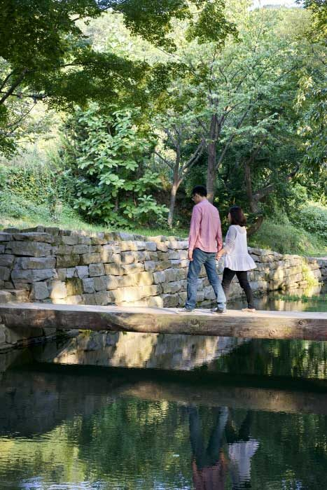

연못 외나무다리 · 사진 한국관광공사

---
layout: magazine
class: tight
---

# 04 · 야식 장보기 — 동부시장

서산 사람들의 부엌. 저녁이 적다는 후기가 있으니, 시장을 한 바퀴 돌며 끌리는 걸 골라 가요.

<Chip color="ai">주차</Chip> 당간지주앞 무료 공영주차장(시장 190m) · <Chip kind="fill">주의</Chip> 시장 공영주차장 공사 중

<Grid cols="3" gap="10">
<Tile kind="soft" color="ok" tag="🕘 둘러보기" title="09~19시 · 상설시장">장날 없이 매일 열려요. 14:55 도착 · 30분</Tile>
<Tile kind="soft" color="py" tag="🧭 동선" title="중앙 통로 → 수산 → 골목">먹거리 · 특산품 · 회까지 한 바퀴</Tile>
<Tile kind="soft" color="warn" tag="🏡 객실 비품" title="냉장고 · 와인잔 있음">전자레인지는 없어요</Tile>
</Grid>

<Core color="ai">메뉴는 정하지 않았어요. 다음 쪽 시장 명물을 보고 현장에서 골라요.</Core>

::right::

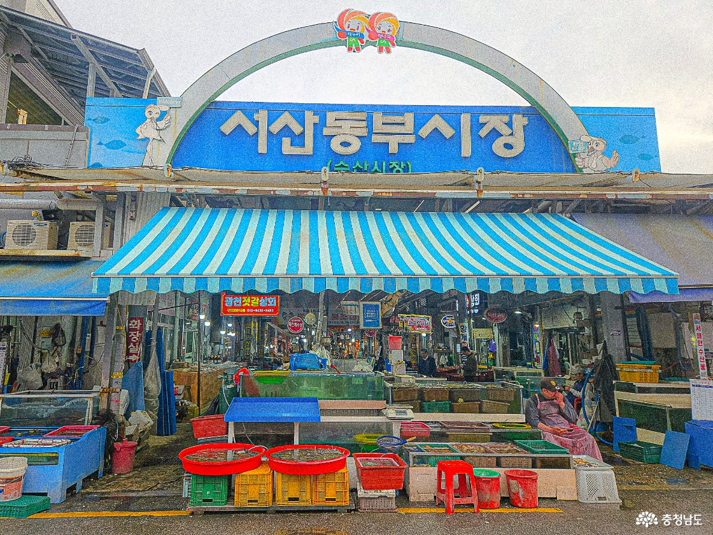

서산동부시장 입구 · 사진 충청남도

<Grid cols="2" gap="8" class="mt-2">
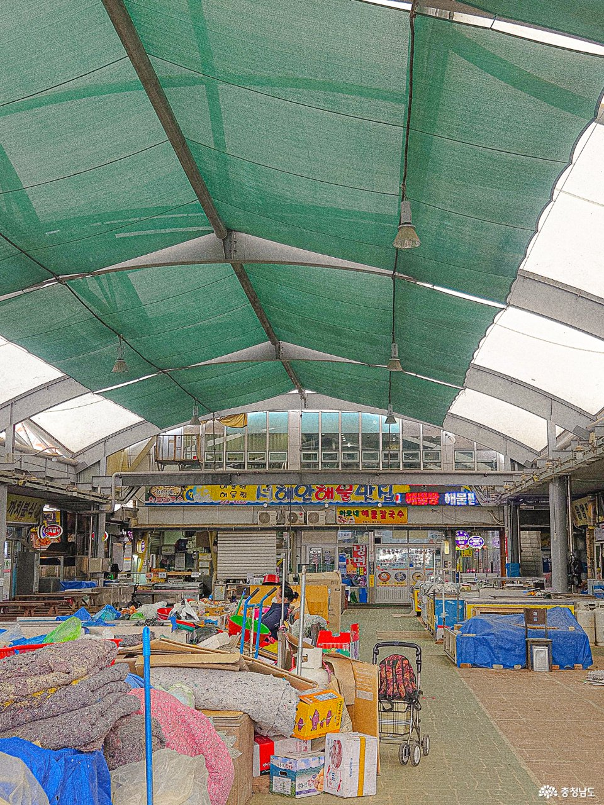
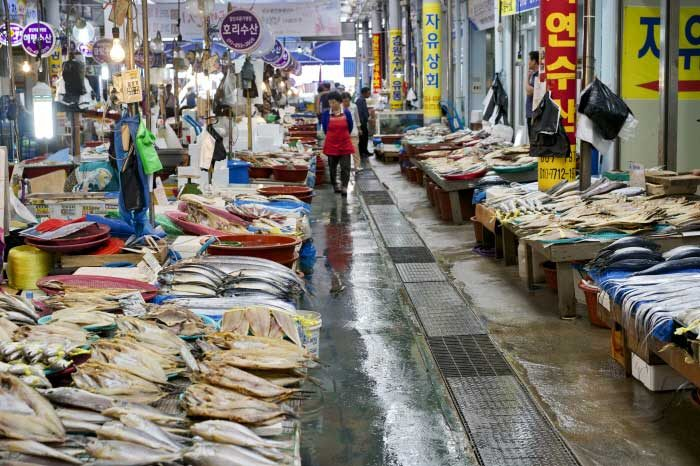
</Grid>

---
class: tight
hideInToc: true
part: 3
eyebrow: dongbu market · 시장 명물
---

# 동부시장 **명물** — 보고 골라요

<Grid cols="4" gap="10">
<figure class="m-0">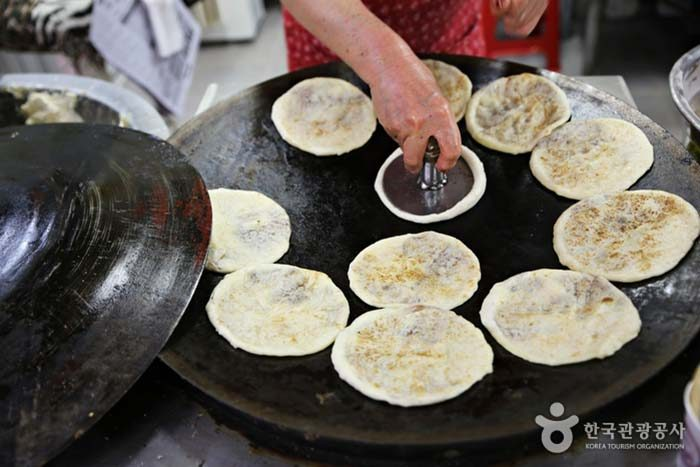<figcaption class="small mt-1"><b>시장원조호떡</b> · 3개 2,000원 '생활의 달인' 솥뚜껑 호떡 · 찐빵 · 팥죽</figcaption></figure>
<figure class="m-0">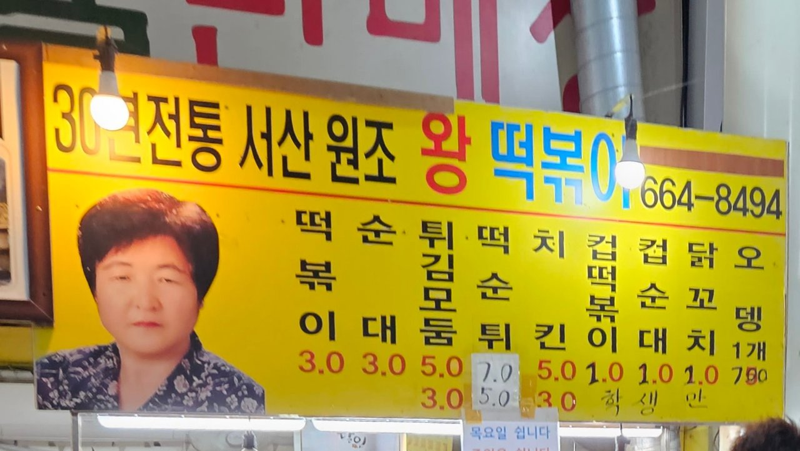<figcaption class="small mt-1"><b>원조왕떡볶이분식</b> · 떡순튀 5,000원 30년 시장 분식 · 컵떡볶이 1,000원</figcaption></figure>
<figure class="m-0">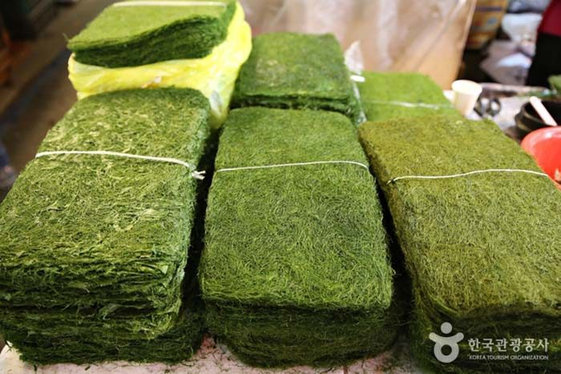<figcaption class="small mt-1"><b>감태</b> · 3봉 10,000원 서산 바다 해초 · 시식하고 사요</figcaption></figure>
<figure class="m-0">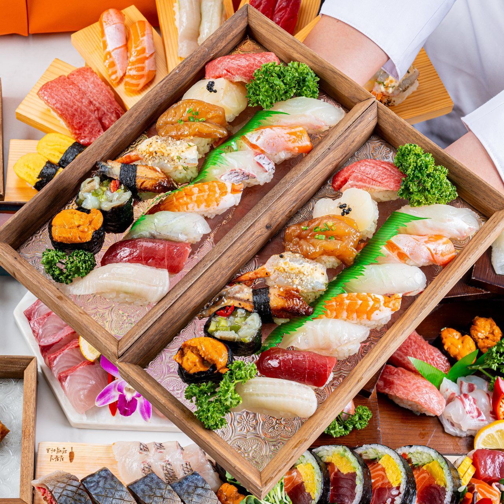<figcaption class="small mt-1"><b>민영활어공장</b> · 초밥 14,000~20,000원 포장 전문 · 모둠회 소 20,000원</figcaption></figure>
<figure class="m-0">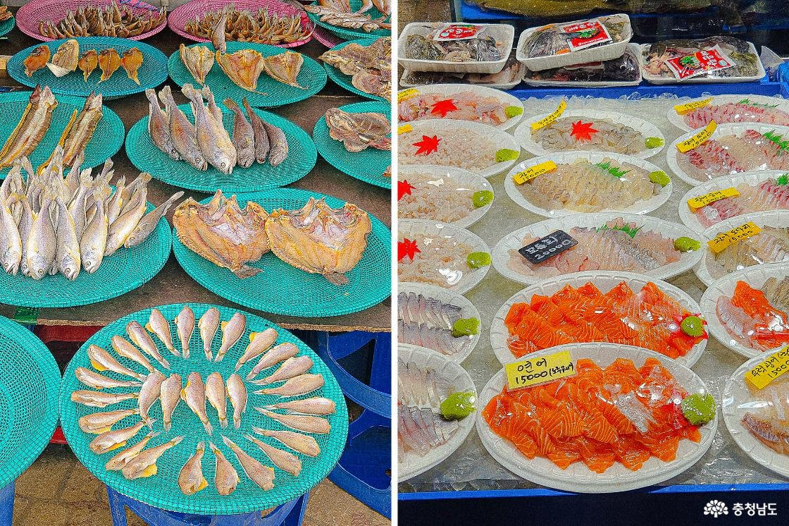<figcaption class="small mt-1"><b>동부 수산시장</b> · 시세 회 · 말린 생선 · 사 오면 요리해 주는 집도</figcaption></figure>
<figure class="m-0">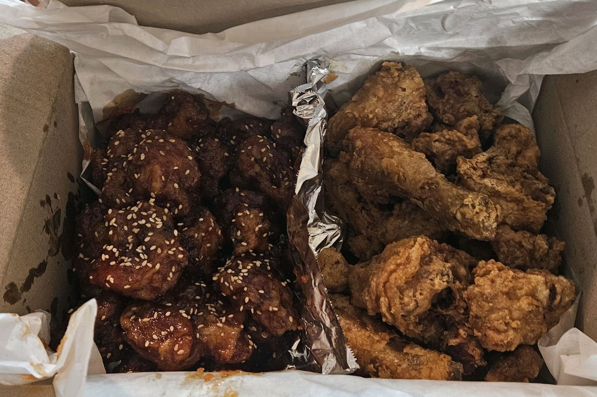<figcaption class="small mt-1"><b>양대닭집</b> · 후라이드 17,000원 시장 통닭 · 닭강정 1팩 5,000원 · 포장</figcaption></figure>
<figure class="m-0">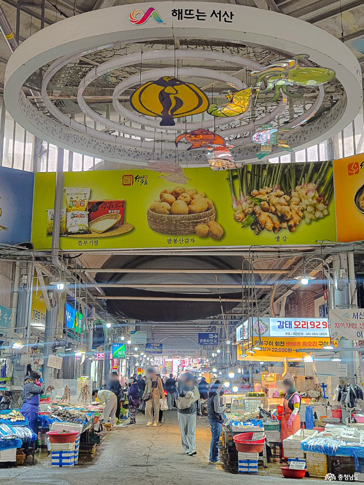<figcaption class="small mt-1"><b>서산 특산품</b> 어리굴젓 · 6쪽마늘 · 생강 · 꽃게장</figcaption></figure>
<figure class="m-0"><figcaption class="small mt-1"><b>직거래장터 골목</b> 레트로 포토존 · 쌈지공원 벤치</figcaption></figure>
</Grid>

<Core color="ai">석식이 일식이라 호떡 · 떡볶이 · 닭강정 · 감태처럼 따뜻하고 고소한 걸 곁들이면 겹치지 않아요.</Core>

---
layout: magazine
class: tight
---

# 🏡 서라온 · 수림3

저수지와 대나무숲 옆의 료칸형 독채 14채. 수림3은 <b>이끼 정원 + 호수뷰 자쿠지</b> 객실이에요.

<Chip color="ai">내비 검색</Chip> 서라온 · <Chip kind="fill">주소</Chip> 서산시 음암면 부장양지길 34-35 · ☎ 041-669-1570

<Tile kind="fill" color="yellow" tag="🌿 수림3 한 줄" title="사계절 풍경을 품은 정원, 창을 열면 호수">부드러운 이끼가 바닥을 덮은 개인정원과 호수를 내다보는 자쿠지</Tile>

<Grid cols="3" gap="12">
<Tile kind="soft" color="ok" tag="구성" title="정원 · 자쿠지 · 침실 · 티룸">미니바 · 화장실 1</Tile>
<Tile kind="soft" color="py" tag="인원 · 주차" title="기준 2인 · 최대 3인">독채 · 무료 주차</Tile>
<Tile kind="soft" color="warn" tag="시간" title="체크인 15:00 · 아웃 11:00">15시 반쯤 도착해 노을 전 둘레길</Tile>
</Grid>

::right::

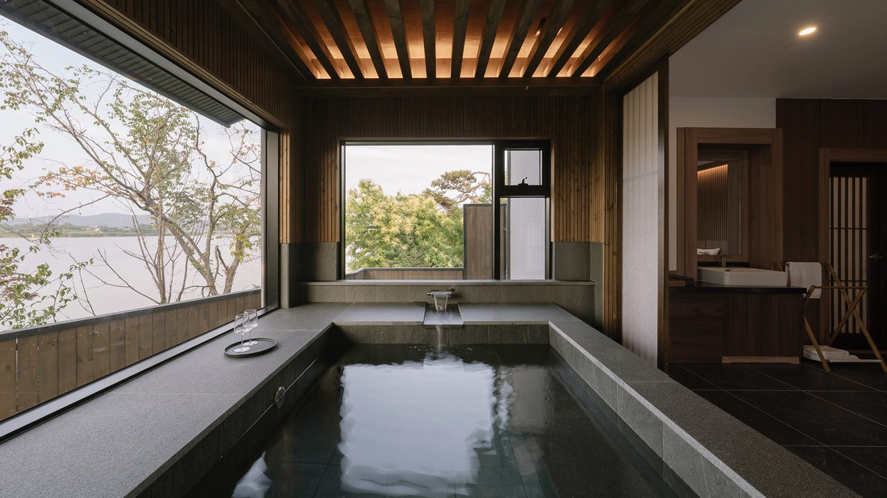

수림3 자쿠지 · 창 너머가 호수

---
hideInToc: true
---

# 🏡-1 · 수림3 **객실 사진**

<Grid cols="3" gap="12">
<figure class="m-0">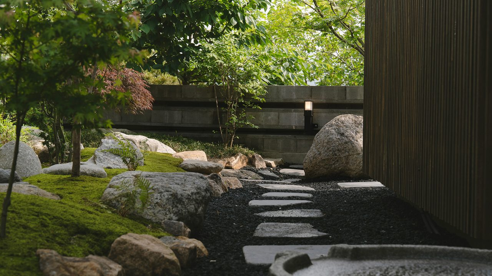<figcaption class="muted small mt-1">이끼 정원과 징검돌</figcaption></figure>
<figure class="m-0">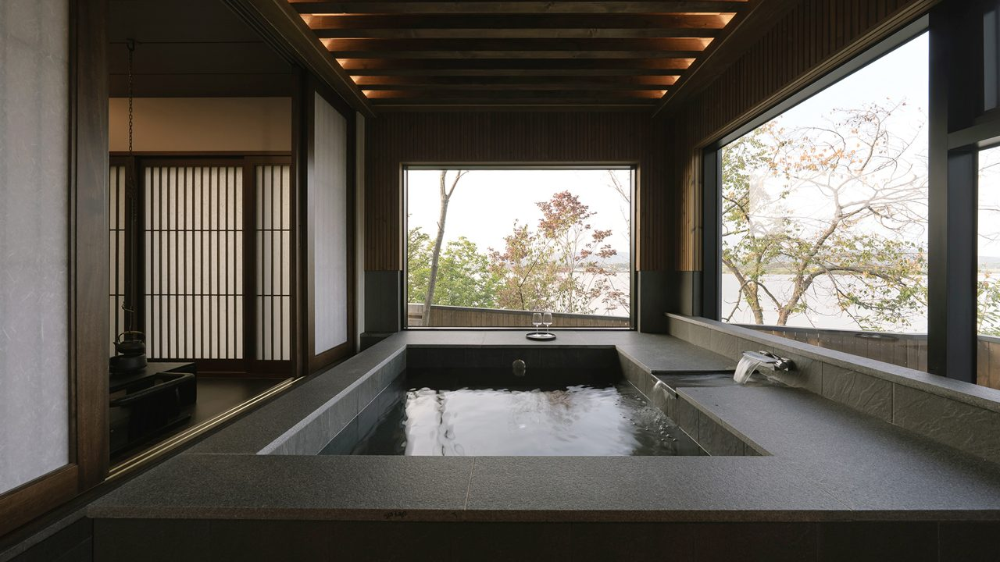<figcaption class="muted small mt-1">호수 쪽으로 열린 자쿠지</figcaption></figure>
<figure class="m-0">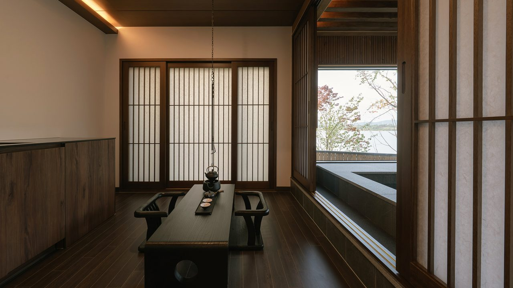<figcaption class="muted small mt-1">좌식 티룸 · 2인 다도세트</figcaption></figure>
<figure class="m-0">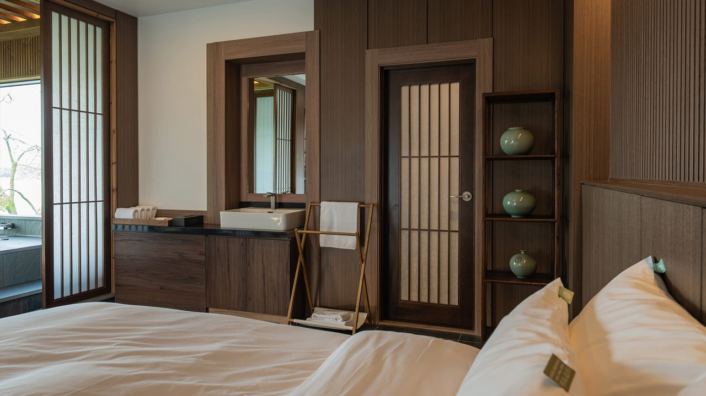<figcaption class="muted small mt-1">원목 침대 · 호텔 침구</figcaption></figure>
<figure class="m-0">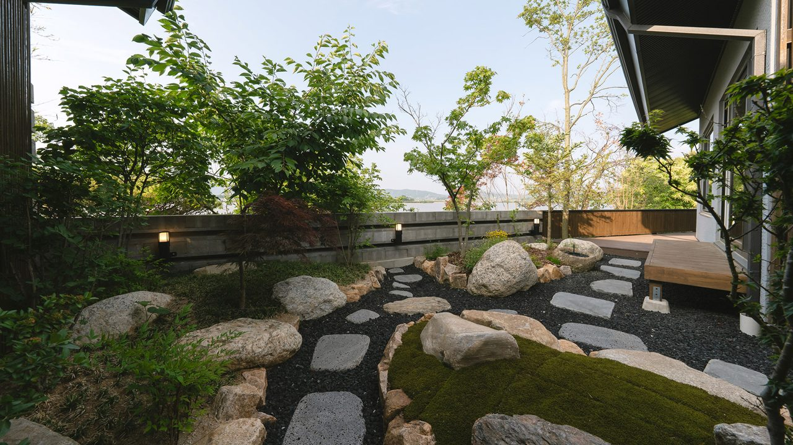<figcaption class="muted small mt-1">툇마루 벤치가 있는 정원</figcaption></figure>
<figure class="m-0">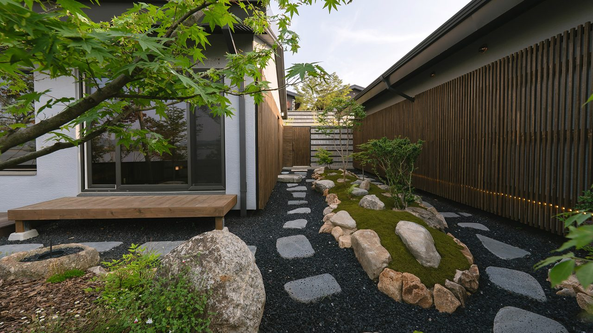<figcaption class="muted small mt-1">해 질 녘 정원 조명</figcaption></figure>
</Grid>

---
class: tight
hideInToc: true
---

# 🏡-2 · 수림3 **객실 시설**

<Grid cols="1fr 420px" gap="0 28">

<Grid cols="2" gap="10">
<Tile kind="soft" color="py" tag="🛋️ 객실" title="냉장고 · 커피포트 · 와이파이">개별 냉난방 · 2인 다도세트 · 물컵 · 와인글라스 · 접시 · 포크 · 와인오프너 · 생수 · 훈증기</Tile>
<Tile kind="soft" color="py" tag="🛁 욕실" title="드라이어 · 수건 4종">페이스 · 배스 · 핸드 · 풋 타월, 친환경 어메니티, 대나무 칫솔</Tile>
<Tile kind="soft" color="py" tag="🛏️ 침실" title="지누스 매트리스 · 원목 침대">호텔식 침구</Tile>
<Tile kind="soft" color="ok" tag="🔥 정원" title="에탄올 화로 · 의자 · 테이블">밤에 불멍하기 좋은 자리</Tile>
</Grid>

<Core color="ai">비품 목록에 전자레인지 · 취사도구는 없어요. 슬리퍼는 정원용 조리가 있어요.</Core>

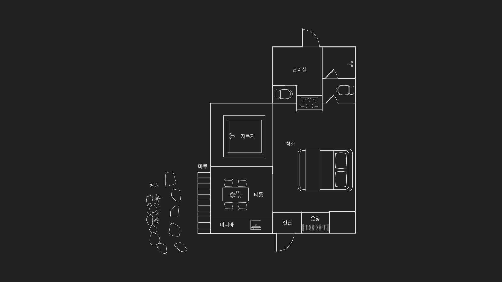

수림3 평면도

<Grid cols="2" gap="8">
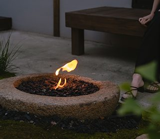
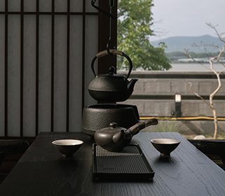
</Grid>

</Grid>

---
class: tight
hideInToc: true
---

# 🏡-3 · 단지 **공용 시설 · 식사**

<Grid cols="1fr 400px" gap="0 28">

<Grid cols="2" gap="10">
<Tile kind="soft" color="ok" tag="🍲 석식 · 담소정" title="스키야키 또는 초밥 · 1인 50,000원">18 · 19시 · <b>사전 예약 필수</b></Tile>
<Tile kind="soft" color="py" tag="🥗 조식 · 담소정" title="샐러드와 커피 · 09시">예약자만 · 유료</Tile>
<Tile kind="soft" color="ok" tag="🎋 호수 · 대나무숲 둘레길" title="잔디정원 → 자작나무 → 대숲">이번 여행 산책의 마무리 코스</Tile>
<Tile kind="soft" color="py" tag="👘 유카타 체험" title="체크인 때 프런트 예약">가격 · 시간은 현장 확인</Tile>
<Tile kind="soft" color="py" tag="🐈 고양이기차역" title="17:00~21:00">기찻길 · 고양이(내부 진입 불가)</Tile>
<Tile kind="soft" color="py" tag="🍬 하꼬방" title="15:00~22:00">구멍가게 감성 소품 · 과자</Tile>
</Grid>

그밖에 라운지 · 서담(북카페) · 야외정원

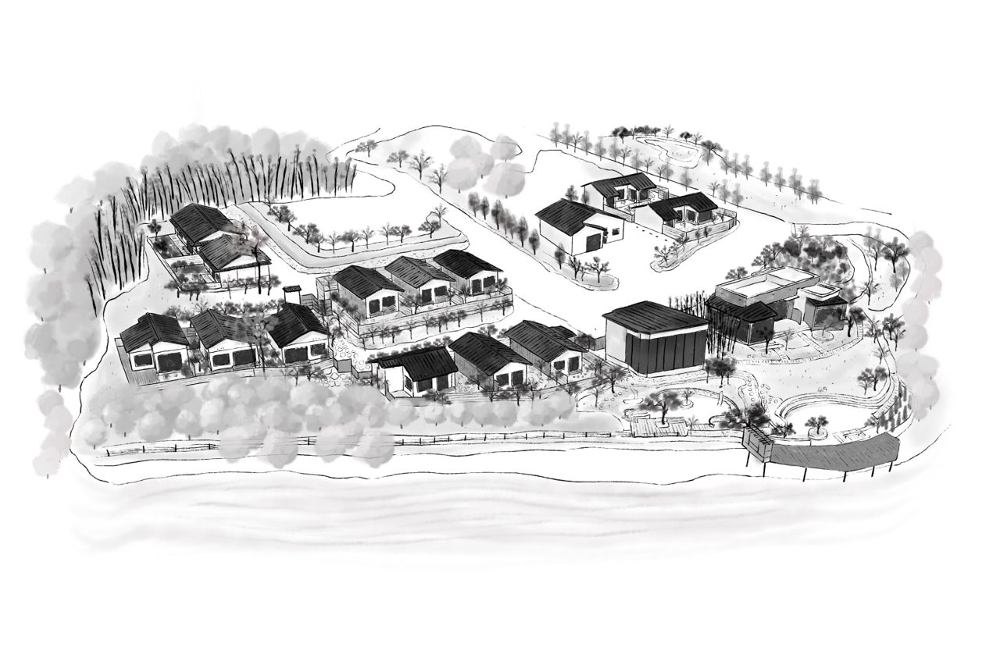

단지 배치도 · 수림1~3은 호숫가 쪽

<Grid cols="2" gap="8">
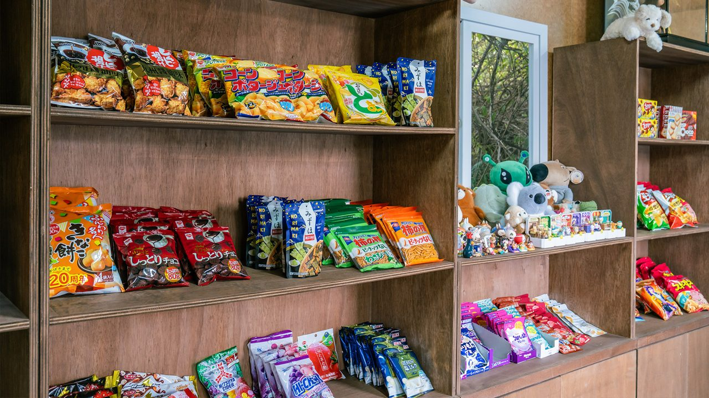
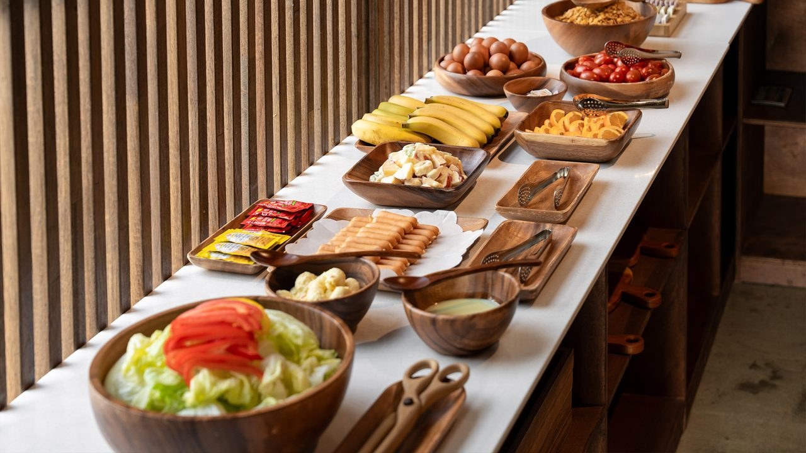
</Grid>

</Grid>

---
class: tight
hideInToc: true
---

### 📸 촬영 포인트 ① 야경 — 토요일 해 질 녘부터 밤까지

<Grid cols="4" gap="12">
<figure class="m-0">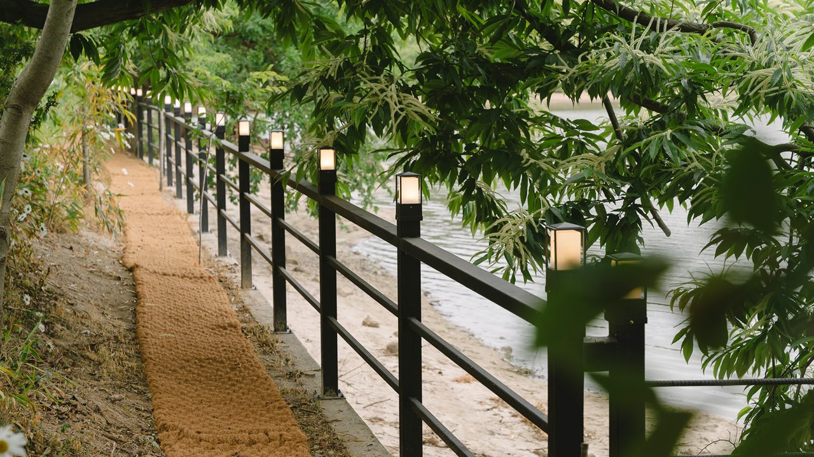<figcaption class="small mt-1"><b>① 호숫가 조명길 · 16:40~17:20</b> 일몰(약 17:16) 전후 하늘이 물들 때. 난간 따라 걷는 뒷모습</figcaption></figure>
<figure class="m-0">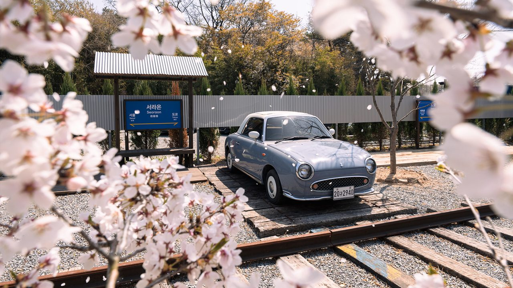<figcaption class="small mt-1"><b>② 고양이기차역 · 17:00~</b> '서라온역' 표지판 · 철길 · 클래식카. 조명 켜진 직후가 예뻐요</figcaption></figure>
<figure class="m-0"><figcaption class="small mt-1"><b>③ 수림3 정원 · 19:30~</b> 정원등과 징검돌. 툇마루에 앉은 유카타 차림 컷</figcaption></figure>
<figure class="m-0"><figcaption class="small mt-1"><b>④ 화로 불멍 · 20:00~</b> 불빛을 얼굴 옆 조명으로. 손 · 찻잔 클로즈업</figcaption></figure>
</Grid>

<Grid cols="3" gap="12" class="mt-4">
<Tile kind="soft" color="ok" tag="📱 야경 팁" title="야간 모드 + 기대어 찍기">난간 · 벤치에 폰을 기대면 흔들림이 줄어요</Tile>
<Tile kind="soft" color="py" tag="💡 빛 활용" title="실내등은 끄고 정원등만">유카타 무늬가 살아나요. 자쿠지 창 안쪽에서 바깥 정원을 찍기도</Tile>
<Tile kind="soft" color="warn" tag="🧥 11월 밤" title="0℃ 안팎">유카타 위에 겉옷 · 핫팩. 짧게 찍고 들어오기</Tile>
</Grid>

---
class: tight
hideInToc: true
---

### 📸 촬영 포인트 ② 유카타 아침 — 일요일 08:00~09:30

<Grid cols="4" gap="12">
<figure class="m-0">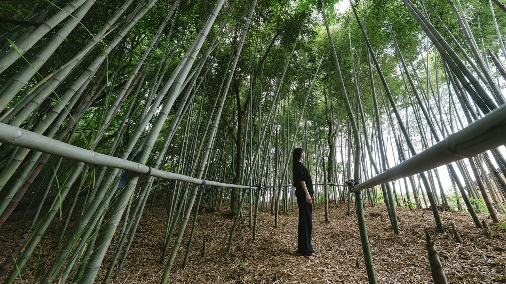<figcaption class="small mt-1"><b>① 대나무숲 길</b> 대숲 사이로 들어오는 아침빛. 걷는 옆모습 · 올려다보는 구도</figcaption></figure>
<figure class="m-0">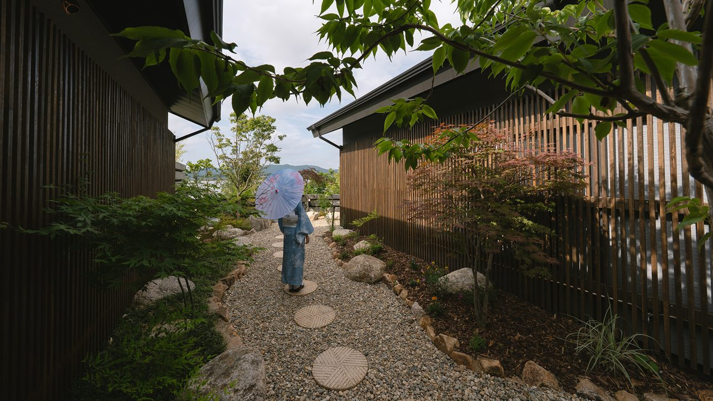<figcaption class="small mt-1"><b>② 객실 정원 징검돌</b> 우산을 들고 징검돌 위를 걷는 뒷모습. 이끼와 단풍이 배경</figcaption></figure>
<figure class="m-0">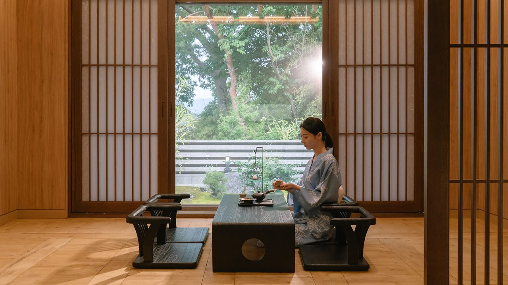<figcaption class="small mt-1"><b>③ 티룸 창가 다도</b> 창으로 드는 역광. 다기세트를 앞에 두고 앉은 컷</figcaption></figure>
<figure class="m-0">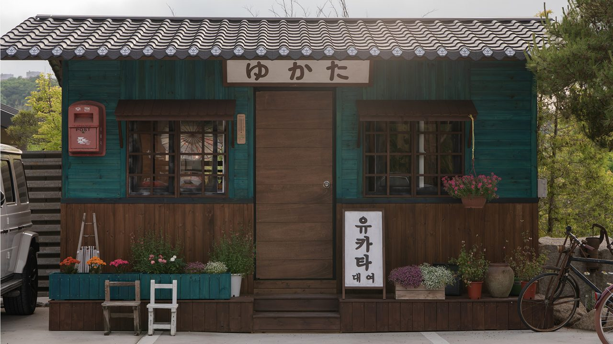<figcaption class="small mt-1"><b>④ 유카타 하우스 앞</b> 'ゆかた' 간판의 옛날 가게. 빨간 우체통 · 자전거와 함께</figcaption></figure>
</Grid>

<Grid cols="3" gap="12" class="mt-4">
<Tile kind="soft" color="ok" tag="🌅 빛" title="일출 약 07:26 · 08~09시가 부드러워요">해가 낮아 그림자가 길고 얼굴이 덜 찡그려져요</Tile>
<Tile kind="soft" color="py" tag="🏞️ 덤" title="잔디정원 · 호수 창틀">호수를 액자처럼 담는 나무 창틀 포토존도 있어요</Tile>
<Tile kind="soft" color="warn" tag="👘 입는 법" title="왼쪽 깃이 위로">오른쪽 깃을 먼저 덮고 왼쪽을 위에. 10:30 전에 반납</Tile>
</Grid>

---
layout: magazine
class: tight
---

# 05 · 점심 — 진국집

40년 넘은 <b>게국지 전문</b> 백반집. 서산에서만 먹는 향토음식으로 여행을 마무리해요.

<Chip color="ai">내비 검색</Chip> 서산 진국집 · <Chip kind="fill">주소</Chip> 서산시 관아문길 19-10 (읍내동 1-22) · ☎ 041-665-7091

<Tile kind="fill" color="yellow" tag="🥬 게국지가 뭐냐면" title="꽃게탕이 아니라 짭짤한 지짐김치">절인 배추 · 호박을 게장 국물로 끓인 서산 김치찌개. 쿰쿰하고 짭짤해서 밥도둑, 호불호는 조금 있어요</Tile>

<Grid cols="3" gap="12">
<Tile kind="soft" color="ok" tag="영업" title="매일 08:30~21:00">일요일 영업 · 브레이크타임 없음</Tile>
<Tile kind="soft" color="warn" tag="주차" title="전용 주차장 없음">골목 앞 1~2대뿐 → 가까운 공영주차장(80~150m)에 세우고 걸어가요</Tile>
<Tile kind="soft" color="py" tag="대기" title="주말 점심 줄 서요">11시 전후 도착이면 여유</Tile>
</Grid>

::right::

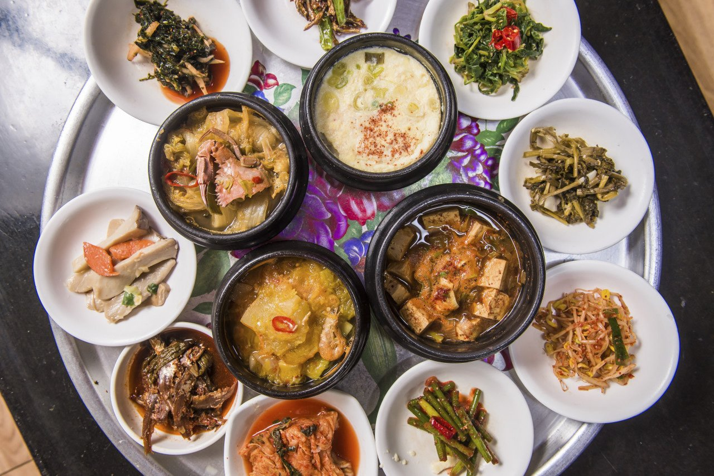

게국지 백반 상차림 · 사진 네이버 플레이스(업체 등록 사진)

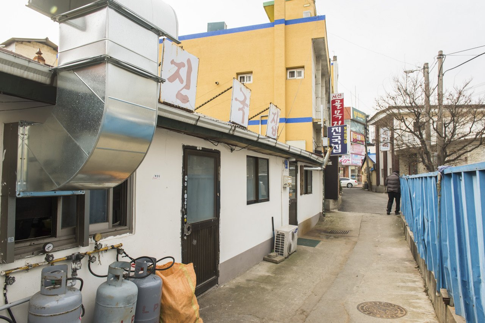

시청 근처 좁은 골목 안쪽에 있어요

---
class: tight
hideInToc: true
---

### 05-1 · 진국집 메뉴 — 현장에서 골라요

<Grid cols="4" gap="10">
<figure class="m-0">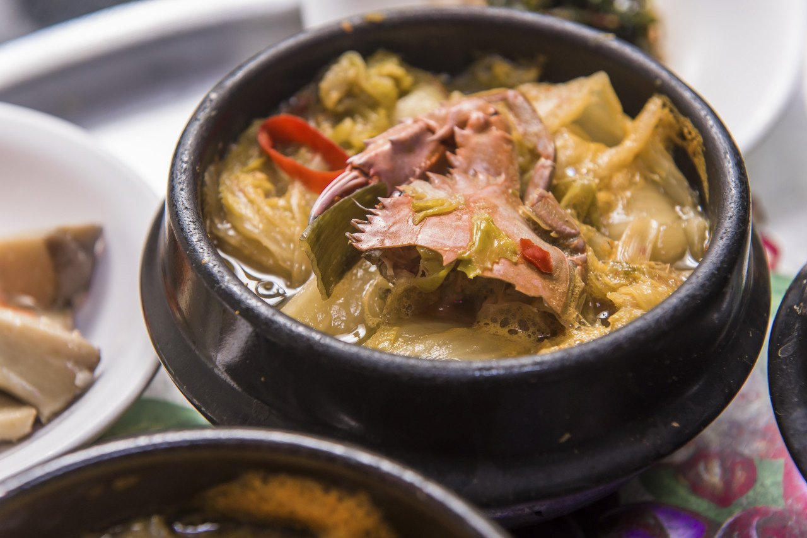<figcaption class="small mt-1"><b>백반(게국지) 1인 12,000원</b> 게국지 · 계란찜 포함, 반찬이 한 상</figcaption></figure>
<figure class="m-0">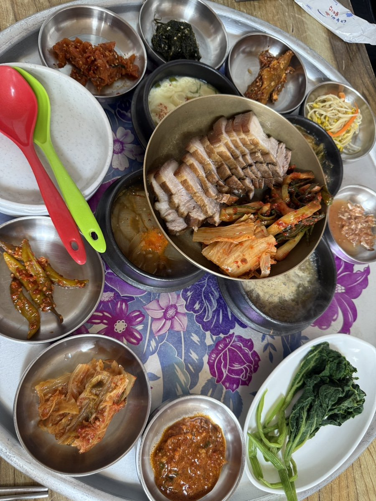<figcaption class="small mt-1"><b>백반 + 수육 2인 38,000원</b> 세트 · 제육볶음 · 오징어볶음도 같은 값</figcaption></figure>
<figure class="m-0"><figcaption class="small mt-1"><b>백반 + 보리굴비 2인 38,000원</b> 굴비 1마리 · 후기에서 많이 추천</figcaption></figure>
<figure class="m-0"><figcaption class="small mt-1"><b>호박지찌개</b> 늙은호박 김치찌개 · 백반에 같이 나와요</figcaption></figure>
<figure class="m-0">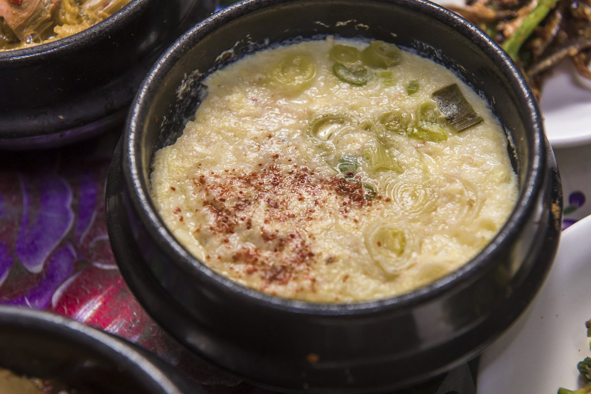<figcaption class="small mt-1"><b>계란찜</b> 백반에 포함 · 추가 2,000원</figcaption></figure>
<figure class="m-0">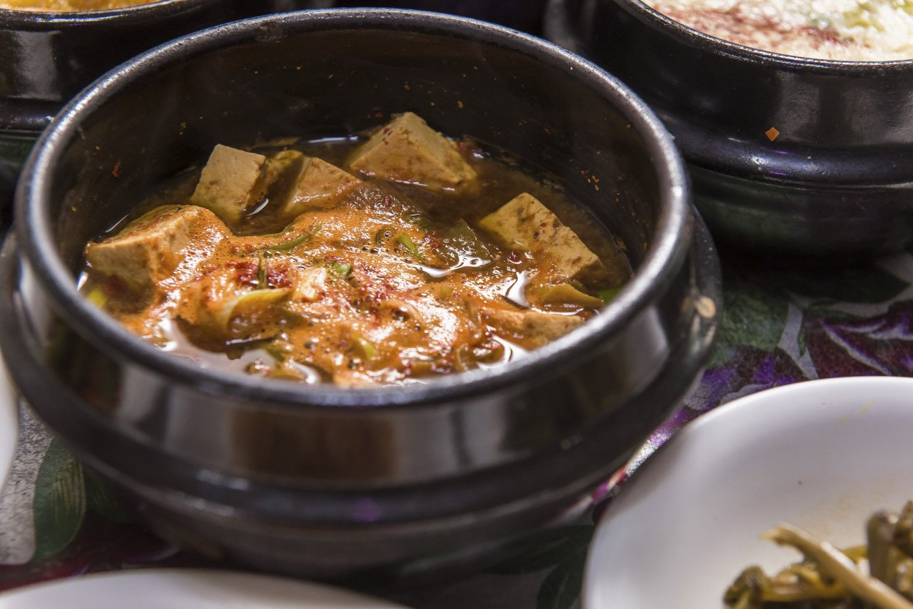<figcaption class="small mt-1"><b>된장찌개</b> 짠맛을 달래 주는 순한 국물</figcaption></figure>
<figure class="m-0">
<b>🐟 서산 특산물</b>우럭젓국 70,000원우럭포찜 65,000원2인 기준
<figcaption class="small mt-1"><b>우럭젓국 · 우럭포찜</b> 든든하게 먹고 싶을 때</figcaption></figure>
<figure class="m-0">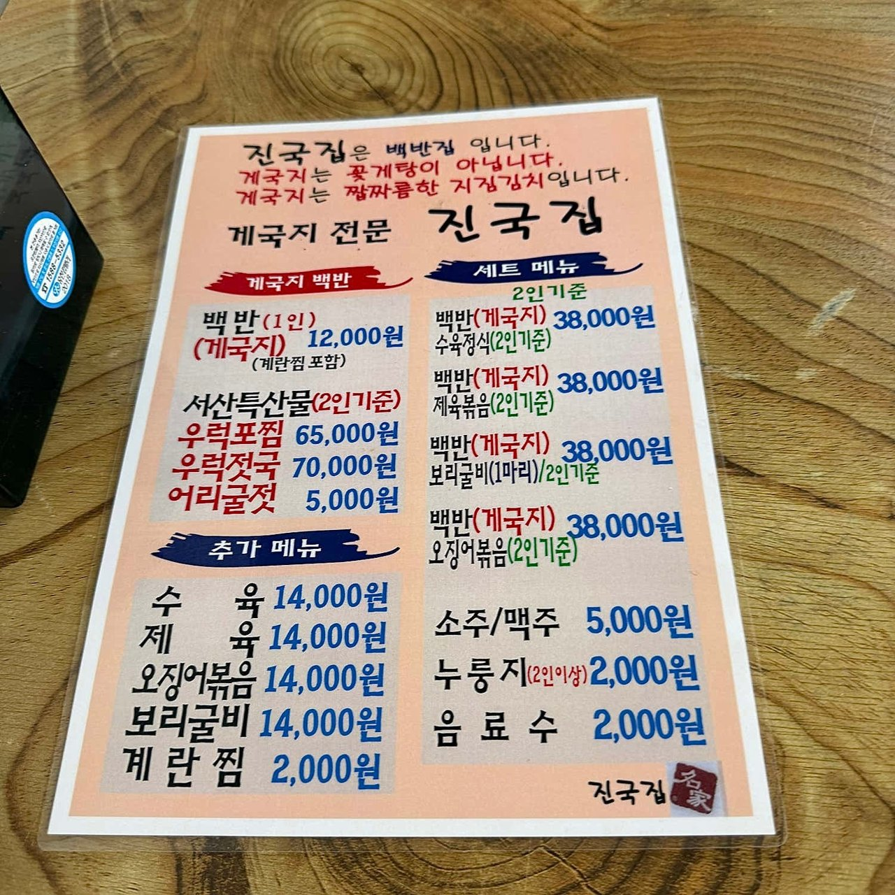<figcaption class="small mt-1"><b>가게 차림표</b> 추가: 수육 · 제육 · 보리굴비 각 14,000원</figcaption></figure>
</Grid>

<Core color="ai">둘이라면 세트 1개(2인) 38,000원으로 충분해요. 게국지가 처음이면 짠맛을 덜어 줄 <b>수육</b>, 생선을 좋아하면 <b>보리굴비</b>.</Core>

---
layout: cover
mesh: none
hideInToc: true
eyebrow: " "
---

SEE YOU IN SEOSAN · 11.28 – 11.29

<h1>느긋하게 걷고, <strong>따뜻하게 쉬는</strong> 이틀</h1>

성곽과 솔숲을 천천히 걷고, 밤엔 정원 불멍 · 아침엔 대숲에서 유카타 사진 · 마지막은 게국지 한 상

📞 출발 전 예약 · 전화

<ul>
<li><b>서라온 석식</b> 18시 · 1인 50,000원 · 그날 메뉴 물어보기 · 041-669-1570</li>
<li><b>유카타 체험</b> 미리 전화 또는 체크인 때 프런트</li>
<li><b>진국집</b> 예약 없음 · 11시 전후 도착 · 041-665-7091</li>
</ul>

🎒 챙길 것

<ul>
<li>편한 운동화 · 장갑 · 핫팩 · 따뜻한 겉옷</li>
<li>보조배터리 · 미니 삼각대 (야경 · 유카타)</li>
<li>시장 장바구니 · 2~3일 전 날씨 다시 보기</li>
</ul>

<b>2</b>일<b>5</b>곳<b>~1만</b>보<b>1</b>번의 노을<b>∞</b> 여유

