# 북촌 한옥 노천스파 1박 2일

우쭈쭈님을 위한 궁궐 · 종묘 · 한옥 골목 코스, 숙소는 계동 아날로그 한옥의 스파룸

서울 서초 출발 · 자동차 15분 + 도보 · 토~일 1박 2일 (날짜 미정)

<Timeline color="ai" center>
<li class="now"><b>토 10:00</b>서초 집 출발 현대 계동사옥 주차</li>
<li><b>01</b>창덕궁 · 후원 예약 필수</li>
<li><b>02</b>종묘 토요일 자유관람</li>
<li><b>🏡 숙박</b>아날로그 한옥 노천스파 · 스팀사우나</li>
<li><b>03</b>북촌 · 계동 골목 저녁 산책</li>
<li><b>04</b>경복궁 일요일 오전</li>
</Timeline>

<!--
이동 시간: 집(서울 서초구 사임당로19길 88-11) → 계동길 70-24, OSRM 계산 12.7km · 15분(막힘 없을 때). 주말 낮 한남대교 · 종로 정체 시 30~40분.
숙소 좌표: 네이버 플레이스(라온재, 같은 번지) 37.5803, 126.9871.
-->

---

## 코스 한눈에 — 토요일 창덕궁 · 종묘, 일요일 경복궁

1일차 · 토

<Timeline color="py">
<li class="now"><b>10:00</b>서초 집 출발 약 15분</li>
<li><b>10:40</b>현대 계동사옥 주차 → 돈화문 도보 10분</li>
<li><b>11:00</b>창덕궁 전각 50분 → 익선동 점심</li>
<li><b>13:00</b>후원 회차 해설 인솔 90분</li>
<li><b>14:45</b>종묘 1시간 · 자유관람</li>
<li><b>16:00</b>아날로그 한옥 체크인 스파 시간대 선택</li>
<li><b>17:00</b>북촌 골목 산책 19:00 큰기와집 저녁</li>
<li><b>20:00</b>객실 노천스파 → 스팀사우나 · 거실 LP</li>
</Timeline>

2일차 · 일

<Timeline color="ai">
<li><b>08:30</b>한식 조식 8:30 / 9:30 중 선택</li>
<li><b>10:30</b>체크아웃 짐은 숙소에 보관</li>
<li><b>10:50</b>경복궁 2시간 근정전 · 경회루 · 향원정</li>
<li><b>13:00</b>황생가칼국수 점심 소격동</li>
<li><b>14:15</b>운현궁 30분 → 짐 찾기 → 주차장</li>
<li class="now"><b>15:30</b>서초 집 도착</li>
</Timeline>

<Core>후원 예약(관람일 6일 전 10시)이 이 여행의 핵심. 날짜를 정하면 숙소보다 후원 표를 먼저 잡아요.</Core>

<!--
1일차 후원 13:00 회차 기준. 11~2월 한국어 회차는 10 · 11 · 12 · 13 · 14 · 15시. 종묘 입장 마감 16:30(11~1월), 토 · 일은 자유관람.
2일차 경복궁 11~2월 09:00~17:00(입장 마감 16:00). 수문장 교대의식 10:00 · 14:00(흥례문).
-->

---
layout: magazine
class: tight
---

# 🏡 숙소 · 북촌 아날로그 한옥

1930년대 한옥을 고친 게스트하우스. 객실 4개 중 <b>스파 1 · 2 두 방만 객실 전용 노천탕 + 스팀사우나</b>가 있어요.

<Chip color="ai">내비 검색</Chip> 현대 계동사옥 주차장(숙소 전용 주차 없음) · <Chip kind="fill">주소</Chip> 서울 종로구 계동길 70-24

<Grid cols="3" gap="12">
<Tile kind="soft" color="py" tag="입실 · 퇴실" title="15:00~23:00 · 11:00">셀프 체크인(열쇠 보관함) · 짐 보관 가능</Tile>
<Tile kind="soft" color="py" tag="💰 스파룸 2인 · 토" title="날짜 넣고 확인">2021년 후기 토요일 220,000원 · 에어비앤비에서 날짜를 넣어야 요금이 떠요</Tile>
<Tile kind="soft" color="ok" tag="조식 포함" title="한식 · 08:30 또는 09:30">1인 1생선 · 호스트가 직접 차려요</Tile>
</Grid>

- 침대 없이 **온돌 바닥에 요와 이불**, 방마다 전용 욕실
- 공용 거실은 자정까지 · 취사 불가, 물 끓이기 · 전자레인지 · 커피머신은 OK

<Core color="ai">창덕궁 · 종묘 · 경복궁 · 북촌이 모두 도보 15분 안. 차는 하루 종일 세워 둬요.</Core>

::right::

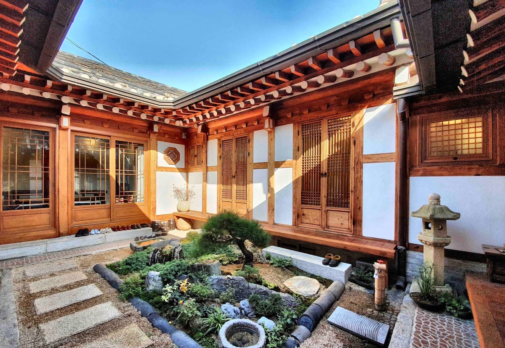

ㅁ자 한옥 마당. 오른쪽 날개가 스파룸 두 개

<!--
출처: 에어비앤비 리스팅 스파#1(rooms/30926196) · 스파#2(rooms/31252831) 2026-11-02 조회 — 입퇴실 · 규칙 · 허가(한옥체험업 2021-000004) · 평점. 가격은 리스팅에 날짜를 넣어야 표시되어 2021-12 블로그(gogoitis) 토요일 결제가를 적음.
사진: 에어비앤비 리스팅 사진
-->

---

### 🏡-1 · 사진으로 보는 객실

<Grid cols="3" gap="12">
<figure class="m-0">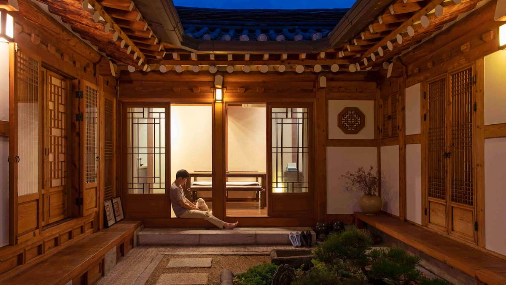<figcaption class="muted small mt-1">밤의 마당. 가운데가 공용 거실(LP · 커피머신)</figcaption></figure>
<figure class="m-0">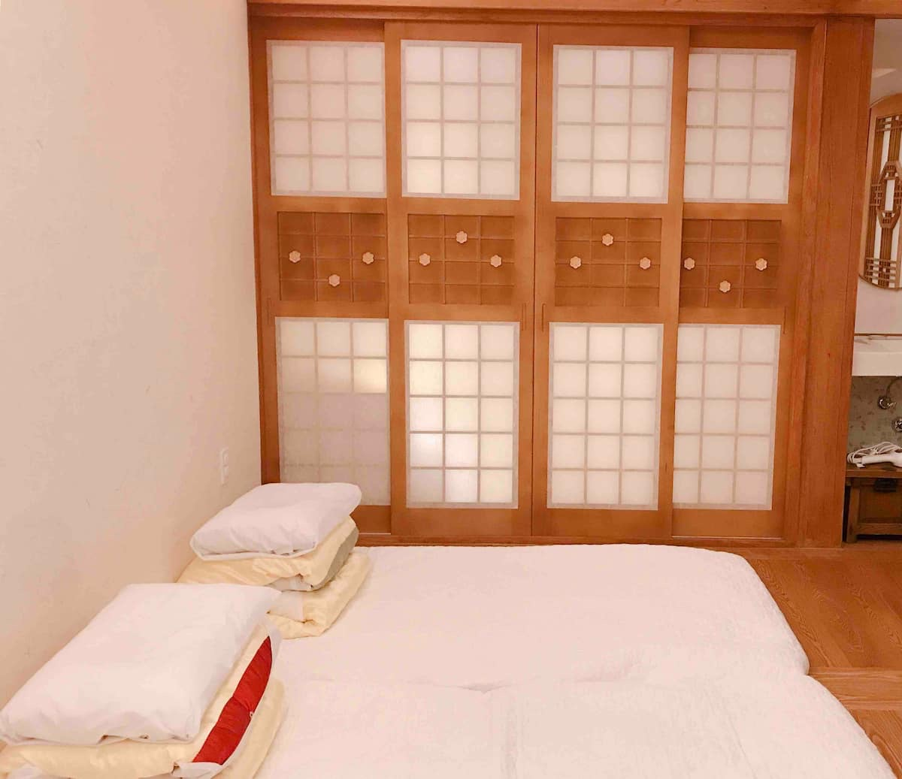<figcaption class="muted small mt-1">스파룸. 온돌 바닥에 요 두 채</figcaption></figure>
<figure class="m-0">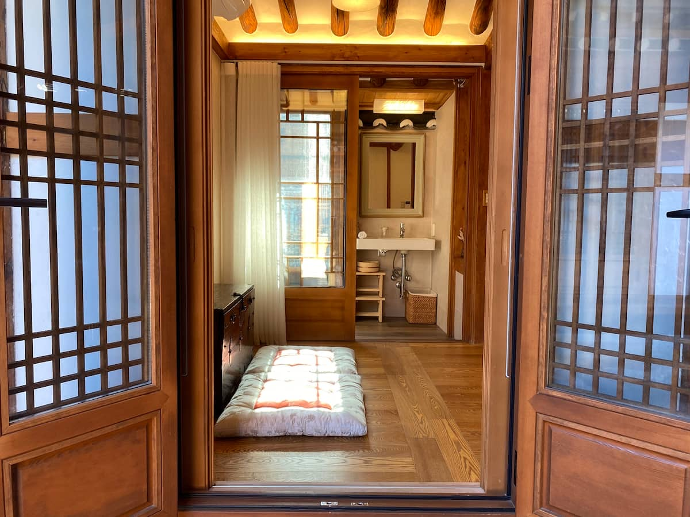<figcaption class="muted small mt-1">스파1에서 본 욕실. 노천탕 바구니와 사우나 의자</figcaption></figure>
<figure class="m-0">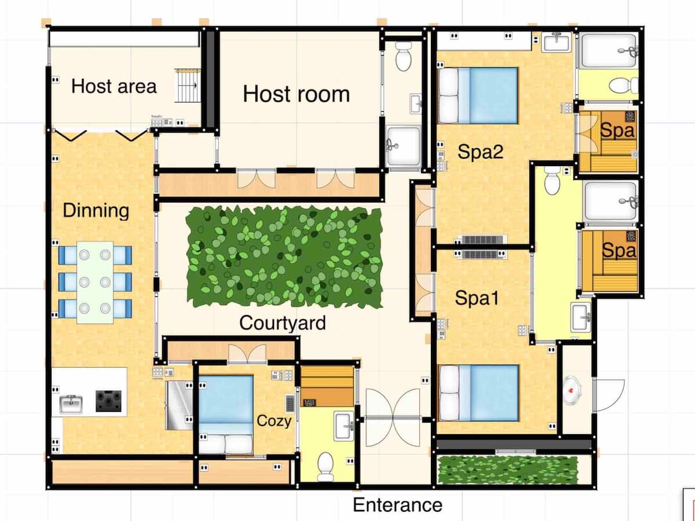<figcaption class="muted small mt-1">평면도. 스파1 · 2 끝에 'Spa'라 적힌 칸이 노천탕</figcaption></figure>
<figure class="m-0">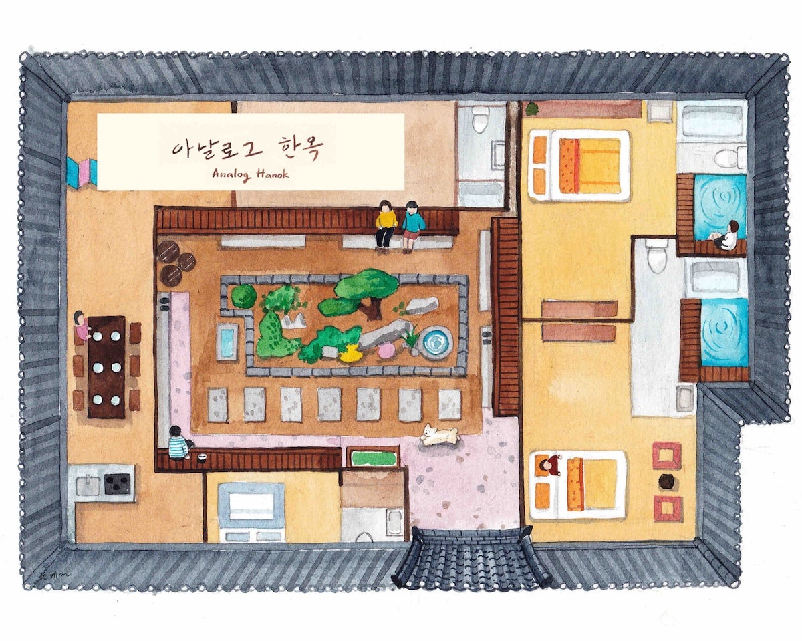<figcaption class="muted small mt-1">호스트가 올린 수채화 조감도</figcaption></figure>
<figure class="m-0">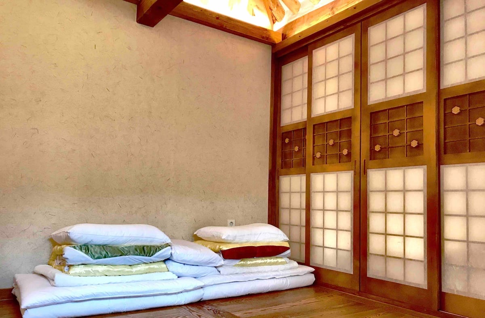<figcaption class="muted small mt-1">한지 창호와 이불. 벽장에 충전기 · 칫솔 치약</figcaption></figure>
</Grid>

<!--
사진: 에어비앤비 리스팅 스파#1 · 스파#2 사진. 노천탕 자체 사진은 리스팅 대표 사진 다섯 장에 없어 평면도로 대신함.
-->

---
class: tight
---

### 🏡-2 · 노천스파 · 사우나 · 주차

<Grid cols="1fr 400px" gap="0 28">

우쭈쭈님이 가장 기대하는 부분. 탕은 객실 안쪽 작은 안마당에 있고 하늘이 뚫려 있어요.

<Grid cols="2" gap="12">
<Tile kind="soft" color="ok" tag="♨️ 노천탕" title="투숙 중 1회 · 1시간">물 받는 시간대 16~17 · 18~19 · 20~21 · 22~23시 중 하나를 체크인 때 골라요</Tile>
<Tile kind="soft" color="py" tag="🧖 스팀사우나" title="욕실 샤워부스 안">나무 의자 비치 · "기대는 적당히"라는 후기</Tile>
<Tile kind="soft" color="warn" tag="🚗 주차" title="현대 계동사옥 · 30분 3,000원">종일권 평일 13,000 · 주말 15,000 · 1박이면 이틀치</Tile>
<Tile kind="soft" color="danger" tag="주의" title="아동 · 반려동물 불가">예약 인원 외 방문 금지 · 목조주택이라 벌레 가능 · 마당 CCTV 4대</Tile>
</Grid>

<Core>탕 깊이가 넉넉하다는 후기. 11월 밤엔 20~21시 시간대가 저녁 뒤 바로라 제일 편해요.</Core>

조감도 오른쪽 위, 파란 물이 두 스파룸의 노천탕

</Grid>

<!--
노천탕 시간대: 2024-10 블로그(jiwon8215) "4~5시/6~7시/8~9시/10~11시 중 한 시간". 1회 사용: 2021-12 블로그(gogoitis).
주차: 에어비앤비 리스팅 "전용주차장 없음, 5분 거리 현대 계동사옥 공용주차장". 요금은 모두의주차장(30분 3,000 · 초기 30분 무료) · 블로그(종일권 평일 13,000 · 주말 15,000). 야간 요금은 현장 확인.
-->

---
class: tight
---

### 🏡-3 · 예약 방법

<Grid cols="2" gap="12 28">

에어비앤비(기본 경로)

<Steps type="list" color="py">
<li>에어비앤비 앱에서 <b>"스파 # 2 _아날로그_하녹_북촌"</b> 또는 <b>"스파 # 1_아날로그_한옥_북촌"</b> 검색 (호스트: 한준)</li>
<li>날짜 · 성인 2명 넣으면 요금 표시 → <b>예약 요청</b>(즉시 예약 아님, 응답률 100% · 몇 시간 내)</li>
<li>승인되면 결제. 24시간 안에는 무료 취소, 그 뒤엔 호스트 환불 정책(체크인 일주일 전까지 부분 환불)</li>
<li>체크인 전날 메시지로 <b>조식 시간(8:30 / 9:30)</b>을 알려요</li>
</Steps>

그 밖의 경로 · 고르는 법

- **전화 · 문자** 010-7463-1110 (응대 08:00~23:00) — 빈방 · 요금 직접 문의
- **트립닷컴**에도 '아날로그한옥'으로 등재(요금 미표시 · 조식 없음으로 적혀 있어 에어비앤비가 정확)
- 2020년엔 ASIAYO, 2021년엔 네이버 모두 홈페이지 예약도 있었지만 지금 확인되는 건 에어비앤비뿐
- **스파1 vs 스파2**: 둘 다 노천탕 + 스팀사우나. 스파1이 방이 조금 넓고 후기가 많고, 스파2는 공용 거실 바로 맞은편

</Grid>

<Core>토요일 밤은 빨리 차요. 후원 표(6일 전)보다 먼저, 2~3주 전에 스파룸부터 요청해 두는 게 안전해요.</Core>

<!--
출처: 에어비앤비 리스팅 2건(예약 요청 방식 · 셀프 체크인 · 환불 안내 "24시간 무료 취소, 11월 7일 전 취소 시 부분 환불"은 11/14 체크인 기준 조회값), 트립닷컴 등재 페이지, 블로그 hyo_vly(2020 ASIAYO) · gogoitis(2021 네이버 모두 · 스파2 토요일 220,000원).
-->

---
layout: magazine
class: tight
---

# 01 · 창덕궁 · 후원

1405년 태종이 지은 궁. 조선 왕들이 가장 오래 산 곳이자 1997년 유네스코 세계유산. <b>후원</b>은 해설사와 함께만 들어가요.

<Chip color="ai">걸어서</Chip> 숙소 → 돈화문 10분 · <Chip kind="fill">주소</Chip> 서울 종로구 율곡로 99

<Grid cols="3" gap="12">
<Tile kind="soft" color="ok" tag="관람 · 11~1월" title="09:00~17:30">입장 마감 16:30 · 월요일 휴궁</Tile>
<Tile kind="soft" color="py" tag="요금" title="전각 3,000 + 후원 5,000">후원 가려면 전각권도 필수</Tile>
<Tile kind="soft" color="warn" tag="후원 회차 · 한국어" title="10~15시 매시 정각">회당 100명 (인터넷 50 + 현장 50)</Tile>
</Grid>

- **후원 예매**: 관람일 빼고 **6일 전 오전 10시**부터, 궁능유적본부 통합예약(ticket.uforus.co.kr) 선착순
- 현장 50장은 당일 09시부터. 10~11월은 둘 다 **매우 빨리 매진**

<Core>13시 회차면 오전 전각 → 점심 → 후원 90분(부용지 · 애련지 · 옥류천)이 딱 맞아요.</Core>

::right::

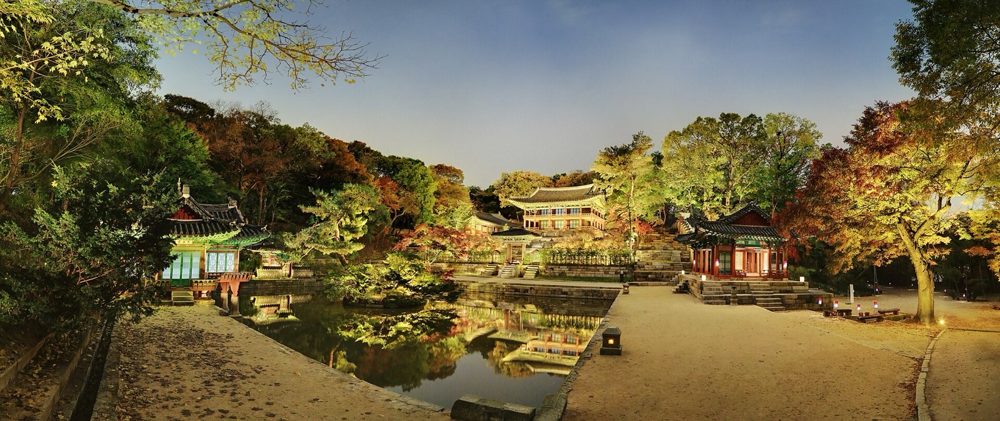

후원 부용지와 주합루

<!--
출처: 궁능유적본부 관람시간(R702000000) · 관람요금(R703000000) 페이지 2026-11-02 조회. 후원 예매 규칙은 관람요금 페이지 특별권 안내 · 궁중문화축전 창덕궁 페이지.
사진: Wikimedia Commons "창덕궁 부용지 (2012)" (문화재청, KOGL 제1유형)
-->

---
layout: magazine
class: tight
---

# 02 · 종묘

조선 왕과 왕비의 신주를 모신 사당. 1995년 유네스코 세계유산, <b>정전은 가로 101m</b>로 우리나라에서 가장 긴 목조건물이에요.

<Chip color="ai">걸어서</Chip> 창덕궁 돈화문 → 종묘 외대문 10분 · <Chip kind="fill">주소</Chip> 서울 종로구 종로 157

<Grid cols="3" gap="12">
<Tile kind="soft" color="ok" tag="토 · 일 · 11~1월" title="09:00~17:30 자유관람">입장 마감 16:30 · 화요일 휴무</Tile>
<Tile kind="soft" color="py" tag="요금" title="1,000원">궁궐 통합권(6,000원 · 4대궁 + 종묘) 쓰면 포함</Tile>
<Tile kind="soft" color="py" tag="평일이면" title="시간제 해설 관람">월 · 목 · 금은 정해진 회차에 해설사와만 입장</Tile>
</Grid>

- 외대문 → 향대청 → **정전** → 영녕전 순서, 가운데 '신로'는 밟지 않아요
- 종묘제례 · 제례악은 유네스코 인류무형유산. 5월 첫째 일요일 종묘대제

<Core>토요일이라 예약 없이 자유관람. 창덕궁 후원을 마치고 걸어가면 1시간이면 충분해요.</Core>

::right::

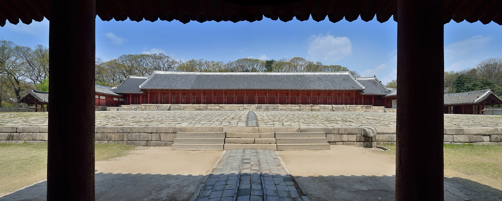

종묘 정전

<!--
출처: 궁능유적본부 관람시간 · 관람요금 페이지(토 · 일 · 공휴일 일반관람, 11~1월 09:00~17:30, 1,000원, 통합권 6,000원).
사진: Wikimedia Commons "Jeongjeon, Jongmyo (Spring, 2013)" (문화재청, KOGL 제1유형)
-->

---
layout: magazine
class: tight
---

# 03 · 북촌 · 계동 골목 산책과 저녁

숙소가 있는 <b>계동길</b>은 카페 · 공방 골목, 언덕 위 <b>북촌로11길</b>(가회동 31번지)이 기와지붕 풍경으로 유명해요.

<Chip color="ai">걸어서</Chip> 숙소 → 북촌로11길 10분 · → 큰기와집 7분

<Grid cols="3" gap="12">
<Tile kind="soft" color="danger" tag="⚠️ 북촌로11길" title="방문 10:00~17:00만">특별관리지역 · 17시 이후 출입하면 과태료(10만원 안팎) · 일요일은 '골목 쉬는 날'</Tile>
<Tile kind="soft" color="ok" tag="대신 저녁엔" title="계동길 · 북촌문화센터 · 백인제가옥 앞">시간 제한 없는 길</Tile>
<Tile kind="soft" color="py" tag="🍽️ 저녁 · 큰기와집" title="17:30~21:00 (마지막 주문 20:00)">북촌로 22 · 간장게장 · 갈비찜 한정식 · 브레이크 15:00~17:30</Tile>
</Grid>

- 16:00 체크인 → 바로 나가면 **17시 전에 북촌로11길**을 잠깐 볼 수 있어요
- 그다음 계동길 → 저녁 → 숙소로 돌아와 **20~21시 노천스파**

<Core>북촌로11길은 주민이 사는 골목이에요. 17시 땡 하면 내려오고, 사진은 조용히.</Core>

::right::

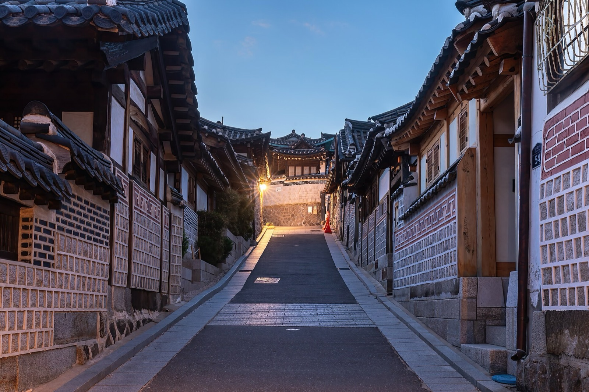

북촌로11길의 해 질 녘

<!--
출처: 서울시 "북촌 특별관리지역 관광객 방문시간 제한 안내"(방문 10:00~17:00, 제한 17:00~익일 10:00), 네이버 법률 블로그(과태료 10만원 안팎), 서울시 인스타그램(일요일 골목길 쉬는 날). 큰기와집: 서울 공식 관광정보 · 다이닝코드(11:30~21:00, 브레이크 15:00~17:30).
사진: Wikimedia Commons "Bukchon-ro 11-gil street … at blue hour" (Basile Morin, CC BY-SA 4.0)
-->

---
layout: magazine
class: tight
---

# 04 · 경복궁 → 점심 → 귀가

1395년 세운 조선의 법궁. 근정전 · 경회루 · 향원정, 바로 옆 국립고궁박물관은 무료.

<Chip color="ai">걸어서</Chip> 숙소 → 경복궁 동문(건춘문) 15분 · <Chip kind="fill">주소</Chip> 서울 종로구 사직로 161

<Grid cols="3" gap="12">
<Tile kind="soft" color="ok" tag="일 · 11~2월" title="09:00~17:00">입장 마감 16:00 · 화요일 휴궁</Tile>
<Tile kind="soft" color="py" tag="요금" title="3,000원">한복 입으면 무료 · 만 24세 이하 · 65세 이상 무료</Tile>
<Tile kind="soft" color="py" tag="수문장 교대" title="10:00 · 14:00 흥례문">20분 · 무료</Tile>
</Grid>

- **점심 황생가칼국수** — 북촌로5길 78 · 11:00~21:30 · 사골칼국수 · 왕만두 각 12,000
- 돌아오는 길 **운현궁**(흥선대원군 집 · 무료 · 월요일 휴관) 30분

<Tile kind="fill" color="yellow" tag="🎁 2026년 10/29~11/15" title="4대궁 · 종묘 무료 개방 · 휴무일도 개방">코리아 그랜드 페스티벌 기간. 창덕궁 후원은 예매 · 유료 그대로</Tile>

::right::

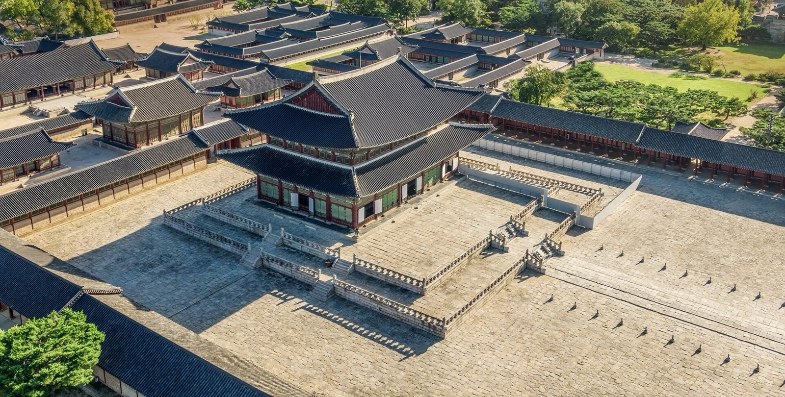

경복궁 근정전

<!--
출처: 궁능유적본부 관람시간 · 관람요금 · 무료관람 대상(한복 착용자). 수문장 교대의식: 국가유산진흥원(10:00 · 14:00, 20분). 황생가: 다이닝코드 · 인스타그램(매일 11:00~21:30, 메뉴 가격). 무료 개방: 궁능유적본부 공지 "2026년 10~11월 궁능유적 휴무일 개방 및 관람객 무료입장 안내"(2026-09-30) · 종묘 코리아 그랜드 페스티벌 관람 안내(2026-10-21). 운현궁 시간은 출발 전 확인.
사진: Wikimedia Commons "경복궁 근정전 전경(궁능유적본부)" (KOGL 제1유형)
-->

---
hideInToc: true
---

정리 · 예약 순서

<Grid cols="2" gap="12 28">

날짜 정하면 바로

<Steps type="list" color="ai">
<li><b>스파룸 예약 요청</b> — 에어비앤비 스파1 또는 스파2, 2~3주 전</li>
<li><b>창덕궁 후원 예매</b> — 관람일 6일 전 오전 10시 정각, 13시 회차 + 전각권</li>
<li><b>큰기와집 저녁 예약</b> — 0507-1448-9032, 토요일 19시</li>
<li>전날 호스트에게 <b>조식 시간</b> · 체크인 때 <b>스파 시간대</b></li>
</Steps>

챙길 것 · 알아둘 것

- 노천탕용 **수영복은 필요 없고**, 머리끈 · 보습제 정도
- 바닥 잠자리(요)라 허리가 예민하면 **코지룸이 아니라 스파룸이어도 요는 같아요**
- 주차는 현대 계동사옥에 하루 15,000원 × 2일 정도. 숙소 골목은 좁아 진입 금지
- 북촌로11길은 17시까지만. 일요일은 아예 안 가요

</Grid>

<Core color="ai">우쭈쭈님, 금산이 '임진왜란과 순교지'였다면 이번엔 '조선 왕실의 공간'이에요. 집에서 15분인데 하룻밤 통째로 다른 시대예요.</Core>

<!--
가격 · 영업시간은 2026-11-02 조사 기준.
-->
