# 도미인 강남 생일 전야 호캉스

우쭈쭈님 탄신일 기념, 퇴근하고 바로 떠나는 하룻밤

12/15(화) ~ 12/16(수) · 도미인 서울 강남 슈페리어 트윈 · 조식 포함 · 버스로 이동

<Timeline color="ai" center>
<li class="now"><b>화 18:20</b>퇴근 4312번 버스</li>
<li><b>18:50</b>호텔 도착 체크인</li>
<li><b>01</b>저녁 식사 세 곳 중 한 곳</li>
<li><b>02</b>대욕장 온천욕</li>
<li><b>03</b>요나키소바 무료 야식</li>
<li><b>🎂 수 아침</b>목욕 · 조식</li>
<li><b>08:45</b>출근 144번 버스</li>
<li><b>12:00</b>우쭈쭈님 체크아웃</li>
</Timeline>

---
part: 3
eyebrow: route · 아이티윌 ↔ 호텔 약 2km · 버스 타는 시간은 3~4분
---

# 회사에서 **호텔까지**, 버스로 오가요

갈 때는 4312번, 올 때는 144번이에요. 정류장에서 호텔까지 걷는 8~9분이 가장 추운 구간이에요.

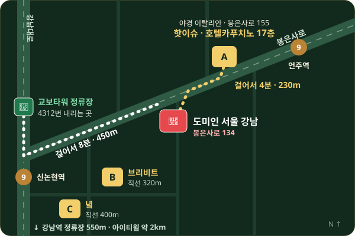

1일차 · 화 12/15 · 18:20 퇴근

<b>회사 → 정류장</b> 신분당선.강남역4번출구 정류장 · 290m · 5분

<b>🚌 4312번</b> 3정거장 · 4분 → 교보타워 정류장 하차

<b>정류장 → 🏨</b> 봉은사로 따라 450m · 8분 → 18:50 호텔

<b>🏨 → 01</b> 저녁 식당 A · B · C · 230~400m · 4~7분

2일차 · 수 12/16 · 08:45 출근

<b>🏨 → 정류장</b> 지하철2호선강남역 정류장 · 550m · 9분

<b>🚌 144번</b> 1정거장 · 3분 → 수협서초지점 하차

<b>정류장 → 회사</b> 290m · 5분 → 09:15 도착 (목표 09:20)

🚌 예비 노선

<b>갈 때 145번</b> 수협서초지점 → 논현역 · 5정거장 · 내려서 500m

---
class: tight
part: 2
eyebrow: schedule · 12/15 화 ~ 12/16 수
---

# 일정 **한눈에** ① — 화요일 밤은 둘이 함께

1일차 · 화 12/15 · 둘이 함께

<Timeline color="py">
<li class="now"><b>18:20</b>아이티윌 퇴근 18:34 버스</li>
<li><b>18:50</b>호텔 도착 체크인 · 짐 풀기</li>
<li><b>19:15</b>저녁 식사 90분</li>
<li><b>20:50</b>호텔 복귀 관내복 갈아입기</li>
<li><b>21:00</b>대욕장 온천욕 50분</li>
<li><b>21:55</b>요나키소바 주문 마감 22:20</li>
<li><b>22:30</b>객실에서 쉬기</li>
</Timeline>

<Grid cols="3" gap="12" class="mt-6">
<Tile kind="soft" color="ok" tag="🚌 퇴근길" title="18:20 퇴근 → 18:50 호텔">4312번 · 걷는 구간은 290m와 450m</Tile>
<Tile kind="soft" color="ai" tag="⏰ 꼭 지킬 시각" title="야식 주문 마감 22:20">21:50에 목욕을 마치면 여유 있어요</Tile>
<Tile kind="soft" color="warn" tag="🌡️ 12월 중순 서울" title="밤 0℃ 안팎 · 일몰 약 17:15">평년 기준 · 2~3일 전 날씨 다시 보기</Tile>
</Grid>

<Core color="ai">저녁을 19:15로 당겨서 목욕 50분과 야식 시간을 넉넉히 뒀어요.</Core>

---
class: tight
hideInToc: true
part: 2
eyebrow: schedule · 12/16 수 · 🎂 탄신일
---

# 일정 **한눈에** ② — 수요일 아침은 출근과 늦잠으로 나뉘어요

2일차 · 수 12/16 · 출근하는 사람

<Timeline color="ai">
<li><b>06:50</b>일어나기</li>
<li><b>07:00</b>아침 목욕 30분</li>
<li><b>07:40</b>조식 뷔페 둘이 함께 45분</li>
<li><b>08:25</b>출근 준비</li>
<li class="now"><b>08:45</b>호텔 출발 08:54 정류장</li>
<li><b>09:15</b>아이티윌 도착 출근 09:30</li>
</Timeline>

2일차 · 우쭈쭈님은 12시까지

<Timeline color="py">
<li><b>07:40</b>조식 뷔페 입장 09:30까지</li>
<li><b>08:45</b>배웅 뒤 객실에서 쉬기</li>
<li><b>09:10</b>대욕장 한 번 더 10:00에 닫아요</li>
<li><b>10:00</b>객실 휴식 짐 정리</li>
<li class="now"><b>11:50</b>체크아웃 퇴실 12시</li>
</Timeline>

<Grid cols="3" gap="12" class="mt-3">
<Tile kind="soft" color="ok" tag="🚌 출근길" title="08:45 출발 → 09:15 도착">144번 · 길 찾기로는 08:55 출발도 09:20 도착</Tile>
<Tile kind="soft" color="ai" tag="⏰ 꼭 지킬 시각" title="대욕장 10:00 · 퇴실 12:00">조식 입장은 09:30까지</Tile>
<Tile kind="soft" color="warn" tag="🌡️ 수요일 아침" title="-3℃ 안팎 · 일출 약 07:40">정류장까지 9분 걸어요. 장갑 · 목도리</Tile>
</Grid>

---
layout: magazine
class: tight
---

# 🏨 도미인 서울 강남

일본 도미인 그대로, <b>대욕장 · 무료 야식 라멘 · 조식 뷔페</b>가 다 있는 온천 호텔이에요.

<Chip color="ai">내비 검색</Chip> 도미인 서울 강남 · <Chip kind="fill">주소</Chip> 강남구 봉은사로 134 · ☎ 02-548-5489

<Tile kind="fill" color="yellow" tag="🧾 예약 내용" title="슈페리어 트윈(10~16층) · 조식 포함 · 233,910원">어른 2명 · 1박</Tile>

<Grid cols="3" gap="12">
<Tile kind="soft" color="ok" tag="🚌 오는 길" title="4312번 · 교보타워 하차">정류장에서 걸어서 8분</Tile>
<Tile kind="soft" color="py" tag="시간" title="체크인 15:00 · 아웃 12:00">공식 홈페이지 예약 기준</Tile>
<Tile kind="soft" color="py" tag="규모" title="객실 220실">2017년 개업 · 대욕장은 지하 2층</Tile>
</Grid>

<Core class="!mt-1">출근하는 사람은 08:45에 나가고, 우쭈쭈님은 12시까지 쉬어요.</Core>

::right::

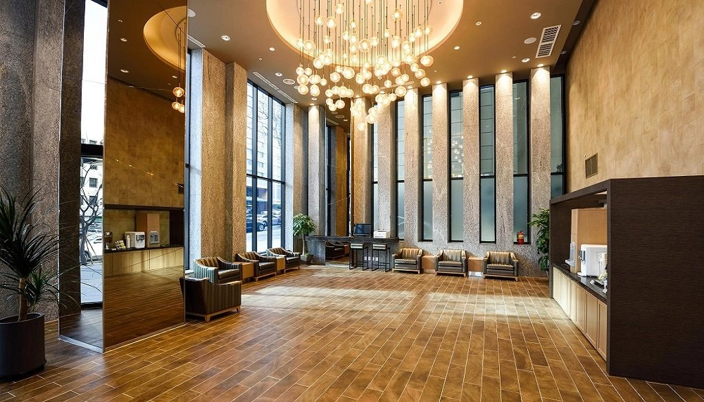

로비 · 사진 도미인 공식 홈페이지

---
class: tight
hideInToc: true
---

# 🏨-1 · 객실과 **호텔 시설**

<Grid cols="1fr 420px" gap="0 28">

<Grid cols="2" gap="10">
<Tile kind="soft" color="py" tag="🛏️ 트윈 객실" title="시몬스 침대 2개 · 21㎡">공식 트윈 기준 면적 · 창밖은 도심 전망</Tile>
<Tile kind="soft" color="py" tag="🛋️ 객실 비품" title="냉장고 · 전기 포트 · 금고">드라이어 · 비데 · 차 · 무료 와이파이</Tile>
<Tile kind="soft" color="ok" tag="👘 관내복" title="입고 대욕장 · 식당까지">객실에 있어요. 갈아입고 다니면 돼요</Tile>
<Tile kind="soft" color="ok" tag="🧺 빌려주는 것" title="충전기 · 와인 오프너 · 베개">프런트에서 무료. 다리미 · 우산 · 담요도</Tile>
<Tile kind="soft" color="py" tag="🧼 세탁 코너" title="지하 2층 대욕장 안">목욕하는 동안 돌릴 수 있어요</Tile>
<Tile kind="soft" color="py" tag="🧳 짐 보관" title="체크인 전 · 체크아웃 뒤 당일">프런트에 맡길 수 있어요</Tile>
</Grid>

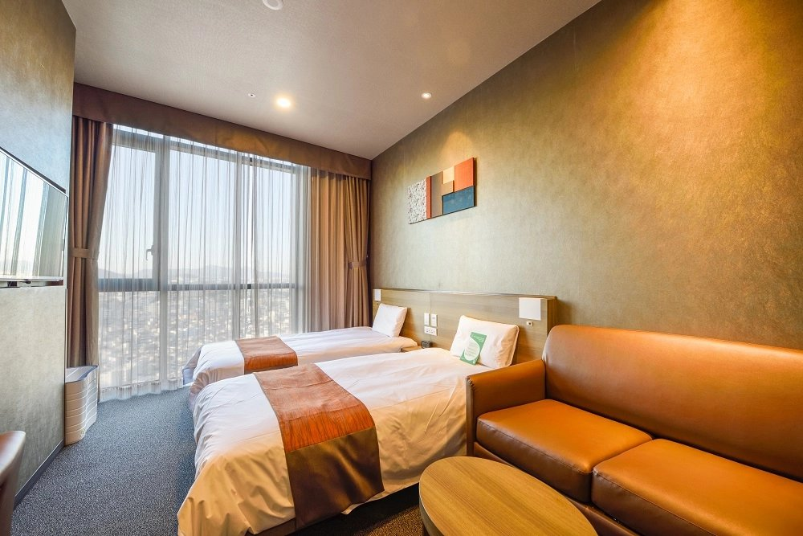

트윈 객실 · 사진 도미인 공식 홈페이지

<Tile kind="soft" color="ai" tag="📸 촬영 포인트" title="밤엔 식당 창가, 아침엔 객실 창가">19:15 저녁 식당 창가 · 로비 샹들리에 · 07:40 일출 뒤 객실 창가 빛</Tile>

</Grid>

---
class: tight
part: 3
eyebrow: dinner · 12/15 화 19:15 · 2명
---

# 01 · 저녁 — **세 곳 중에** 골라요

<Grid cols="3" gap="16">
<figure class="m-0">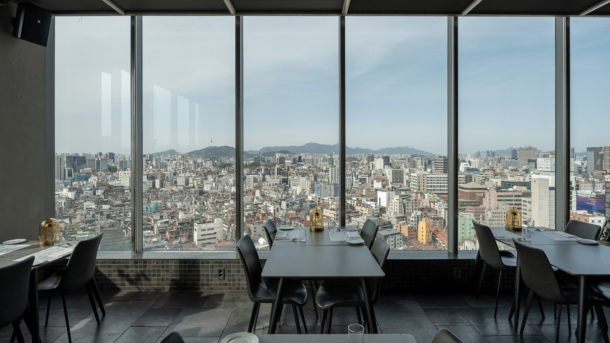<figcaption class="mt-2"><b>A · 레스토랑 핫이슈</b> 17층 통창 야경 · 이탈리안 호텔카푸치노 17층 · 봉은사로 155 호텔에서 230m · 걸어서 4분 화 저녁 17:30~22:30 캐치테이블 · 네이버 예약 · ☎ 0507-1347-9617</figcaption></figure>
<figure class="m-0">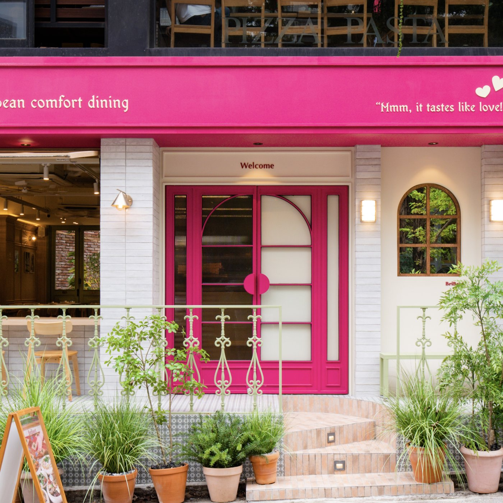<figcaption class="mt-2"><b>B · 브리비트 강남역</b> 분홍 외관 · 식물로 꾸민 그린 테라스 · 유러피안 강남대로102길 31, 1층 호텔에서 직선 320m · 걸어서 6분쯤 매일 11:30~21:15 · <b>주문 마감 20:30</b> 네이버 예약 · ☎ 0507-1351-9197</figcaption></figure>
<figure class="m-0">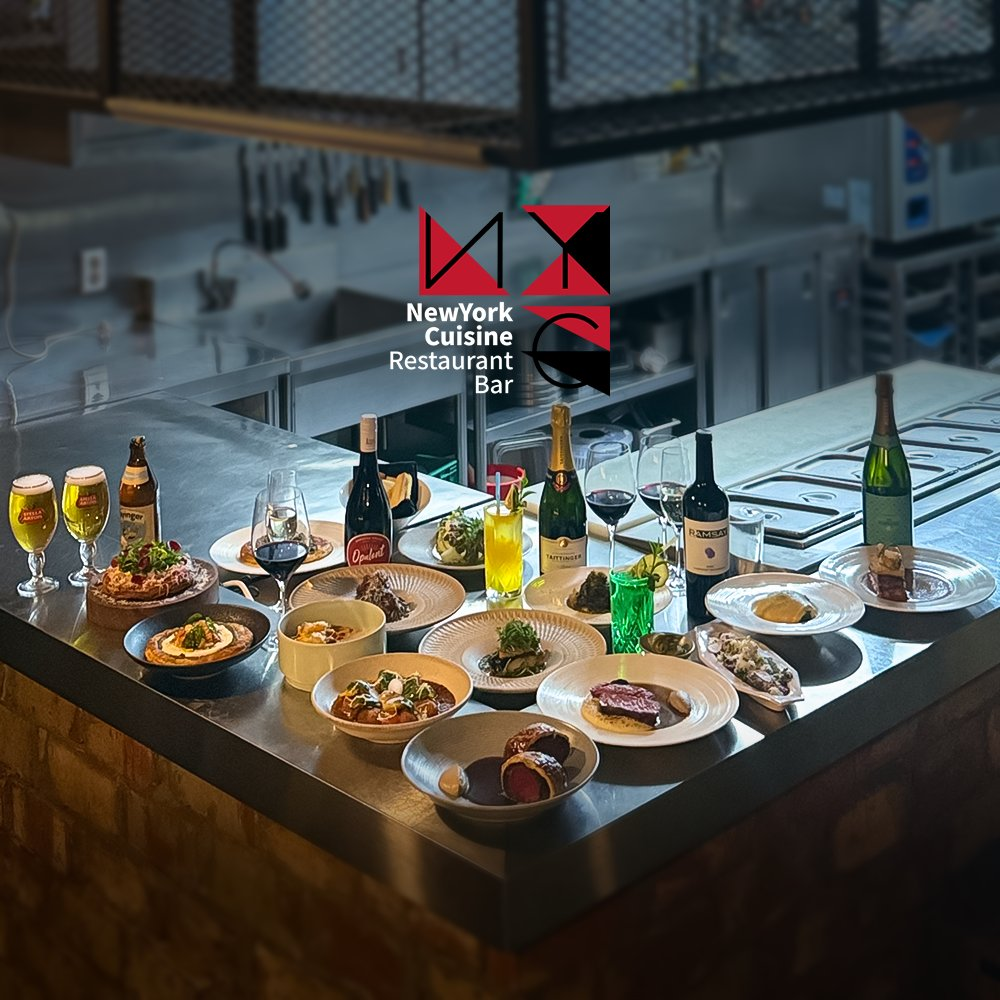<figcaption class="mt-2"><b>C · 녘</b> 바 테이블이 있는 레스토랑 겸 바 · 양식 봉은사로4길 32, 2층 호텔에서 직선 400m · 걸어서 7분쯤 화 저녁 18:00~22:00 캐치테이블 · 네이버 예약 · ☎ 0507-1317-6148</figcaption></figure>
</Grid>

<Core color="ai">야경은 A, 아기자기한 분위기는 B, 술 한 잔 곁들이기는 C가 어울려요. 메뉴는 다음 쪽부터예요.</Core>

사진 네이버 플레이스(업체 등록) · B와 C의 거리는 직선 기준이라 실제로는 조금 더 걸어요

---
class: tight
hideInToc: true
part: 3
eyebrow: dinner · A · 레스토랑 핫이슈
---

# 01-A · **핫이슈** — 이렇게 나와요

<Grid cols="4" gap="12">
<figure class="m-0">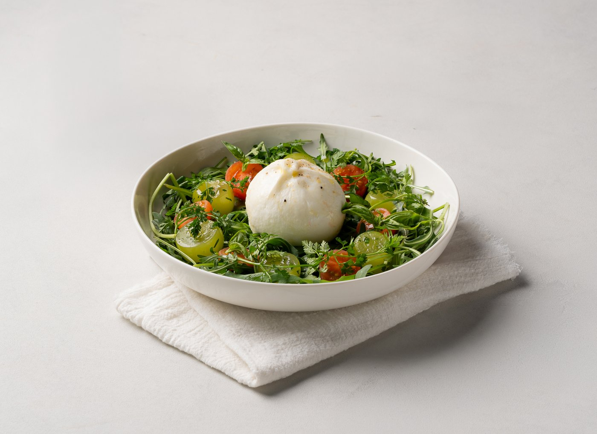<figcaption class="small mt-1"><b>🥗 부라타치즈 샐러드</b> 민트에 절인 샤인머스캣 · 루꼴라 · 토마토잼</figcaption></figure>
<figure class="m-0">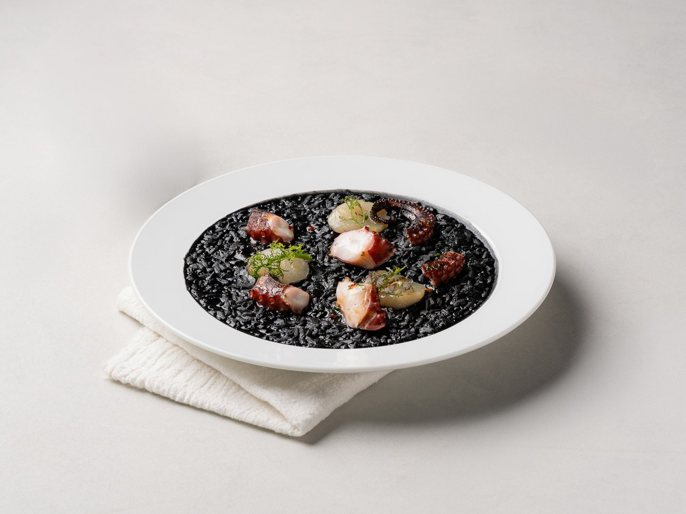<figcaption class="small mt-1"><b>🍚 문어 리조또</b> 먹물 리조또 · 레몬 베샤멜 · 구운 문어와 관자</figcaption></figure>
<figure class="m-0">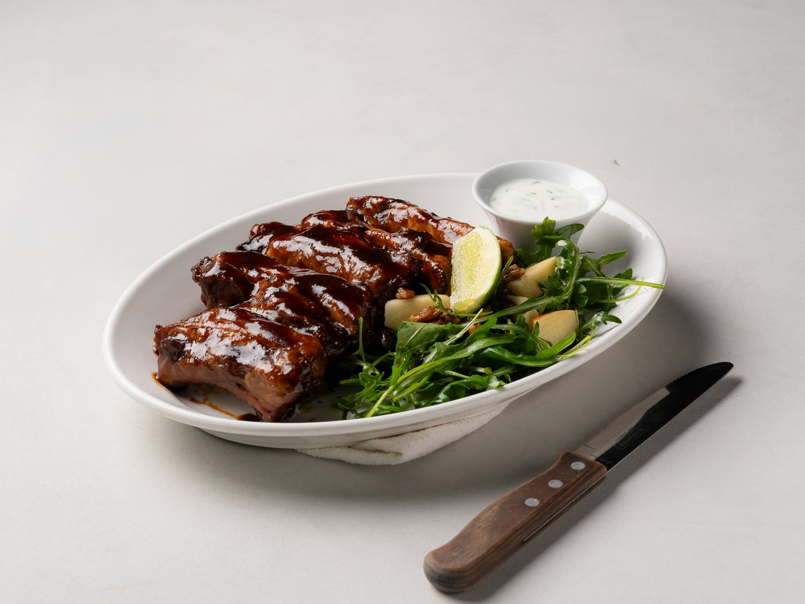<figcaption class="small mt-1"><b>🍖 폭립</b> 바비큐 소스 550g · 루꼴라 샐러드</figcaption></figure>
<figure class="m-0">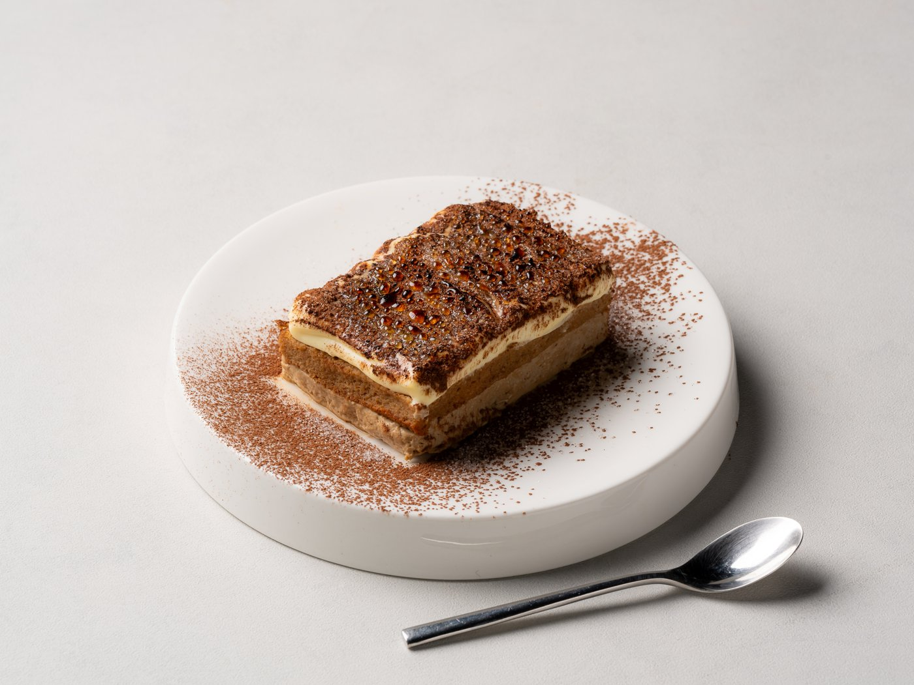<figcaption class="small mt-1"><b>🍰 티라미수 브륄레</b> 설탕을 그을려 올린 마스카포네 티라미수</figcaption></figure>
</Grid>

<Grid cols="3" gap="12" class="mt-4">
<Tile kind="soft" color="ok" tag="🌃 분위기" title="17층 통창 야경">19:15면 불빛이 다 켜져 있어요. 창가 자리 요청</Tile>
<Tile kind="soft" color="py" tag="🍽️ 주문" title="네 접시를 둘이 나눠요">샐러드 → 리조또 → 폭립 → 디저트</Tile>
<Tile kind="soft" color="ai" tag="🍜 뒤에 야식" title="면 요리는 뺐어요">22시쯤 호텔에서 라멘을 먹어요</Tile>
</Grid>

<Core color="ai">세 곳 가운데 가장 격식 있는 자리예요. 스테이크 종류도 여럿 있어요.</Core>

사진 네이버 플레이스(업체 등록)

---
class: tight
hideInToc: true
part: 3
eyebrow: dinner · B · 브리비트 강남역
---

# 01-B · **브리비트** — 이렇게 나와요

<Grid cols="4" gap="12">
<figure class="m-0">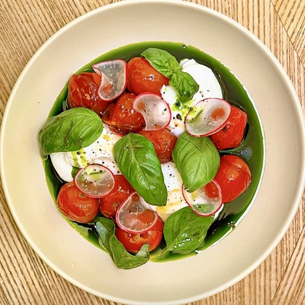<figcaption class="small mt-1"><b>🥗 그릭 요거트 &amp; 토마토 샐러드</b> 그릭 요거트 · 바질 · 토마토</figcaption></figure>
<figure class="m-0">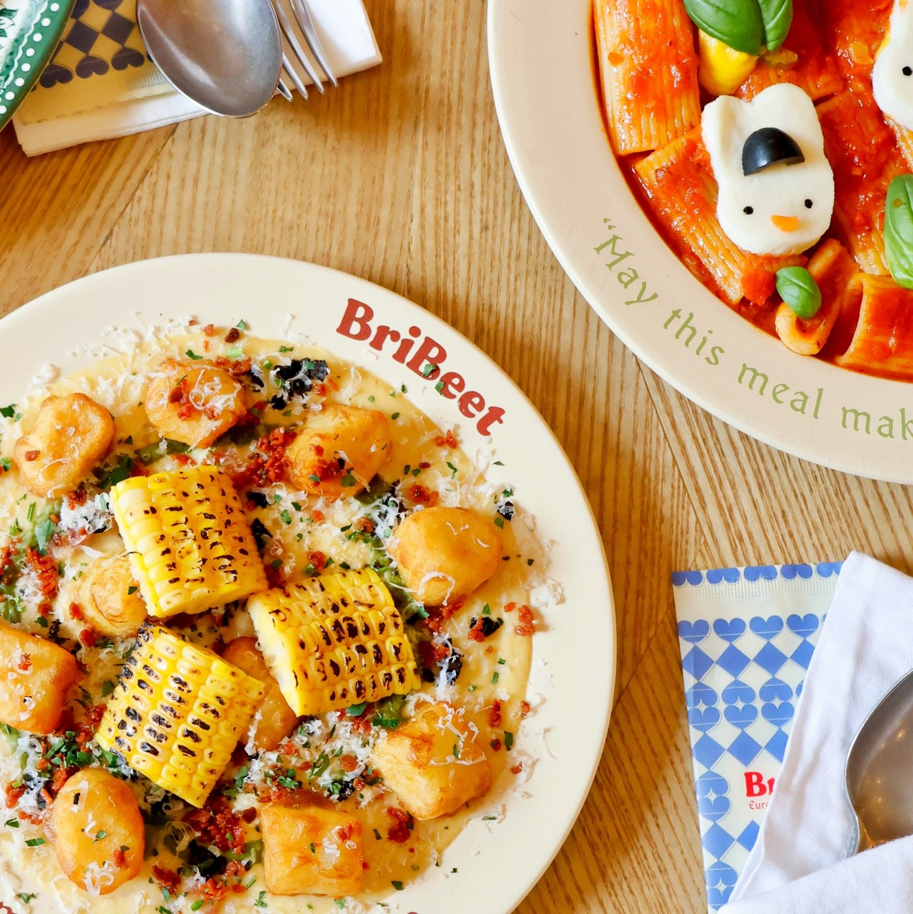<figcaption class="small mt-1"><b>🌽 대파크림 옥수수 뇨끼</b> 직접 빚은 뇨끼 · 대파크림 · 통베이컨</figcaption></figure>
<figure class="m-0">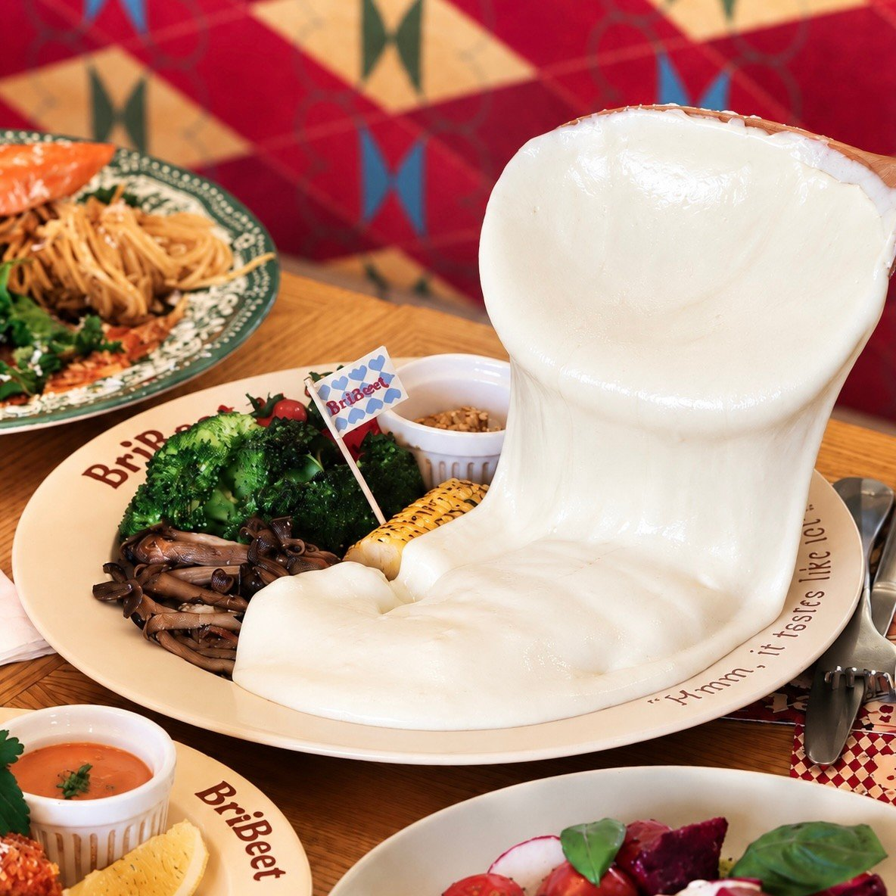<figcaption class="small mt-1"><b>🥩 시그니처 스테이크</b> 수비드 부채살 · 레드와인 소스 · 알리고 치즈</figcaption></figure>
<figure class="m-0">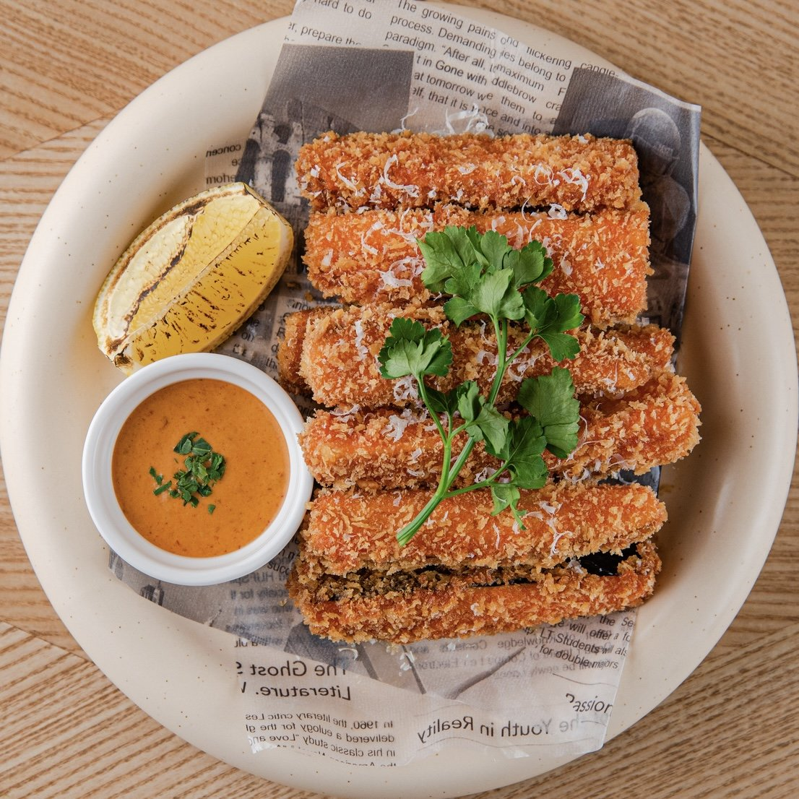<figcaption class="small mt-1"><b>🍆 매콤 가지튀김</b> 겉은 바삭, 속은 촉촉 · 치폴레 소스</figcaption></figure>
</Grid>

<Grid cols="3" gap="12" class="mt-4">
<Tile kind="soft" color="ok" tag="🌿 분위기" title="식물로 꾸민 그린 테라스">분홍색 외관에 아기자기한 실내예요</Tile>
<Tile kind="soft" color="py" tag="🍽️ 주문" title="네 접시를 둘이 나눠요">샐러드 → 뇨끼 → 스테이크 + 가지튀김</Tile>
<Tile kind="soft" color="warn" tag="⏰ 시간" title="주문 마감 20:30 · 21:15 닫음">19:15에 들어가면 여유 있어요</Tile>
</Grid>

<Core color="ai">스테이크에 치즈를 부어 주는 퍼포먼스가 있어 생일 사진 찍기 좋아요.</Core>

사진 네이버 플레이스(업체 등록)

---
class: tight
hideInToc: true
part: 3
eyebrow: dinner · C · 녘
---

# 01-C · **녘** — 이렇게 나와요

<Grid cols="4" gap="12">
<figure class="m-0">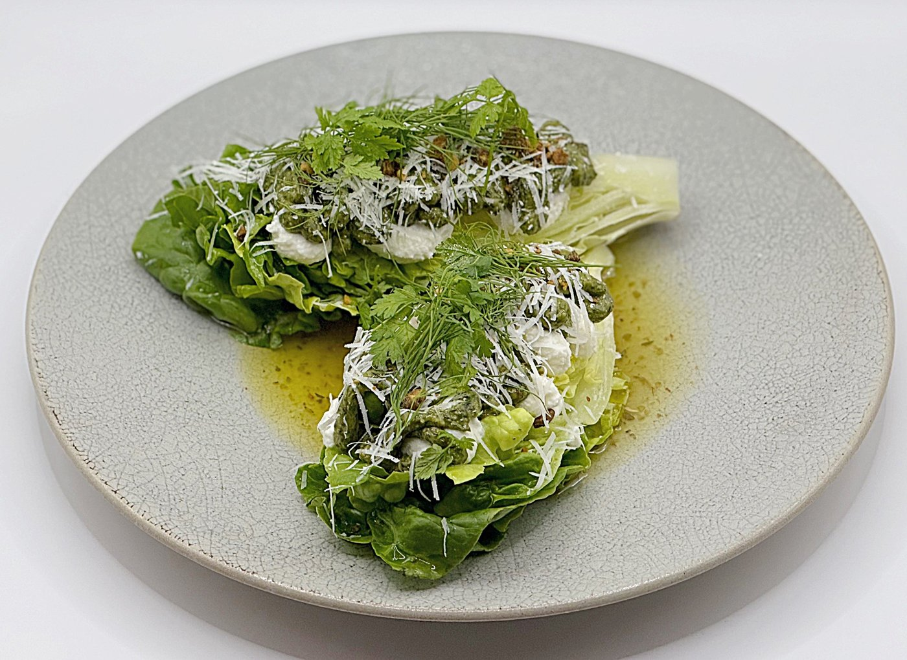<figcaption class="small mt-1"><b>🥗 그린샐러드</b> 미니 코스 · 피스타치오 크럼블 · 허브 시저 드레싱</figcaption></figure>
<figure class="m-0">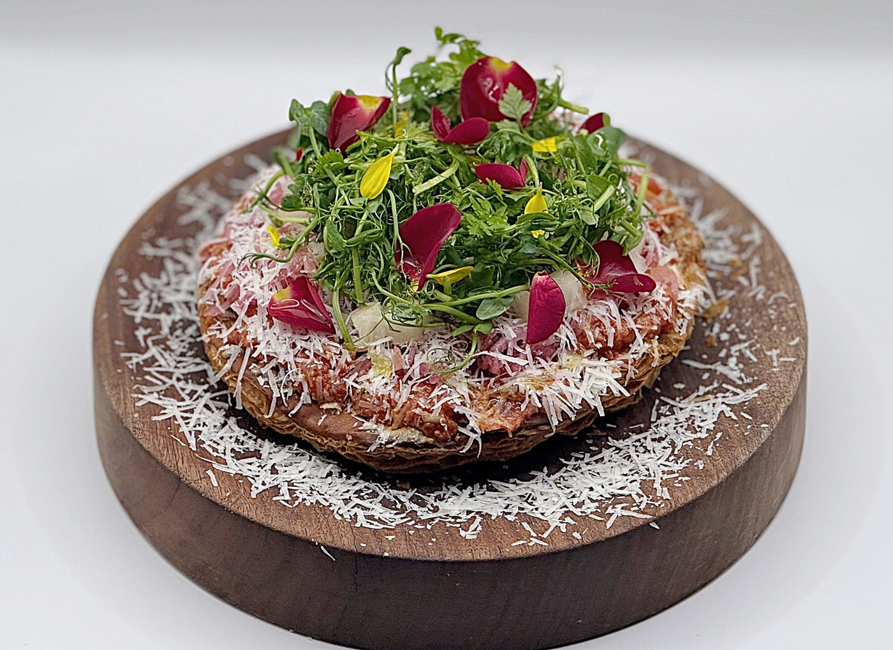<figcaption class="small mt-1"><b>🍕 한우 피자</b> 한우 홍두깨 · 퍼프 페이스트리 · 머스터드</figcaption></figure>
<figure class="m-0">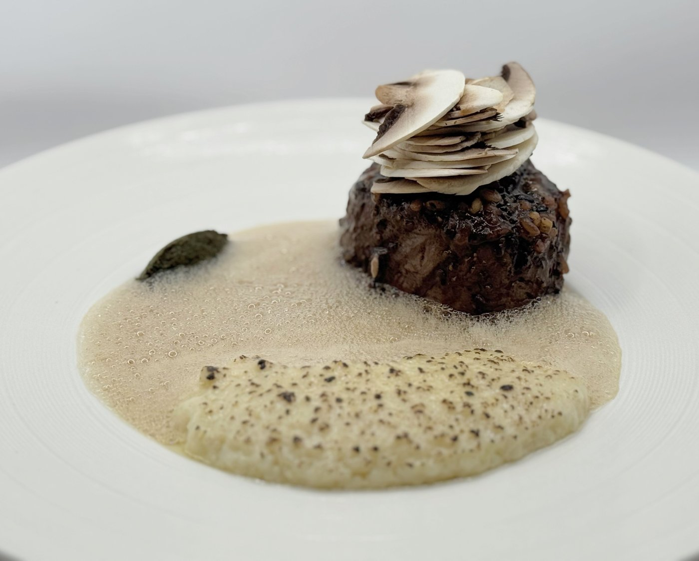<figcaption class="small mt-1"><b>🥩 안심스테이크</b> 와인 갈비 소스 · 양송이 · 페타치즈 그리츠</figcaption></figure>
<figure class="m-0">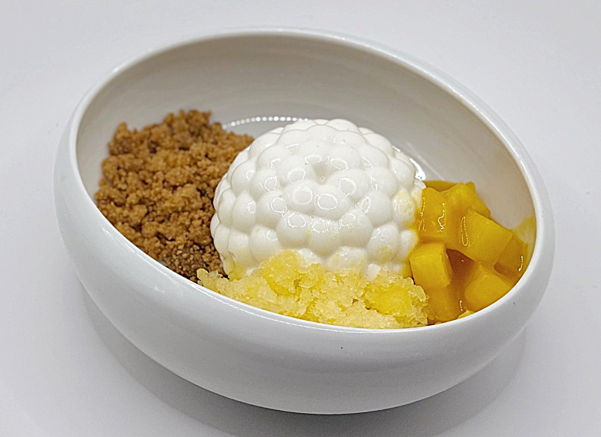<figcaption class="small mt-1"><b>🍮 트로피컬 파나코타</b> 코코넛 파나코타 · 파인애플 샤베트</figcaption></figure>
</Grid>

<Grid cols="3" gap="12" class="mt-4">
<Tile kind="soft" color="ok" tag="🍸 분위기" title="바 테이블이 있는 2층">와인 · 칵테일 종류가 많아요</Tile>
<Tile kind="soft" color="py" tag="🍽️ 주문" title="네 접시를 둘이 나눠요">샐러드 → 한우 피자 → 안심 → 디저트</Tile>
<Tile kind="soft" color="ai" tag="🍜 뒤에 야식" title="파스타는 뺐어요">22시쯤 호텔에서 라멘을 먹어요</Tile>
</Grid>

<Core color="ai">한우 피자는 육회를 올린 페이스트리예요. 날고기가 싫으면 바질새우피자로 바꿔요.</Core>

사진 네이버 플레이스(업체 등록)

---
class: tight
---

# 02 · 대욕장 — **지하 2층 온천욕**

<Grid cols="4" gap="12">
<figure class="m-0">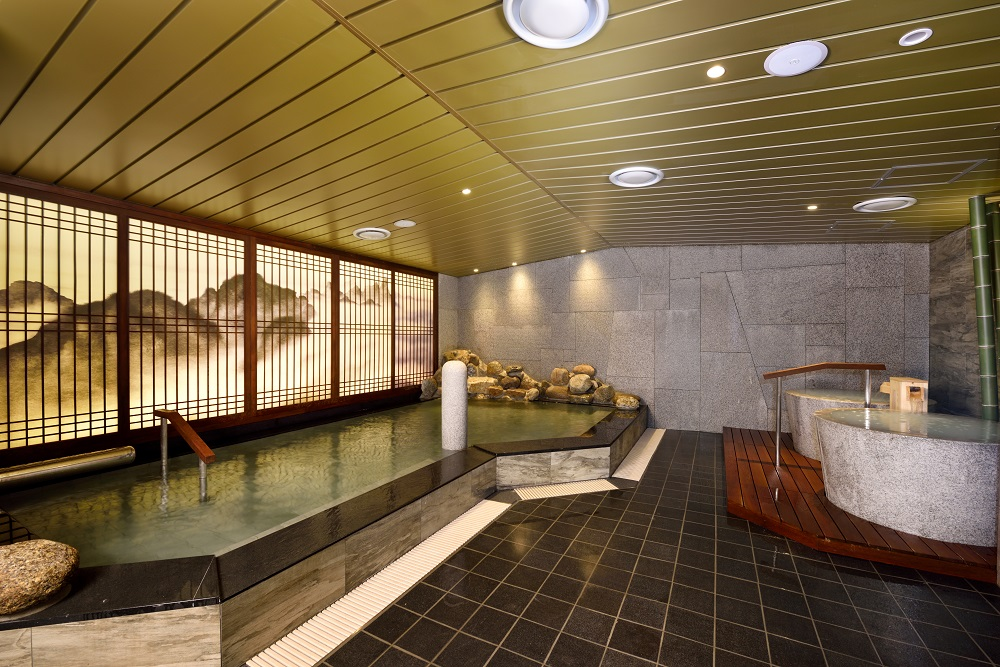<figcaption class="small mt-1"><b>내탕 · 인공 온천</b> 어깨 결림 · 냉증 · 피로 회복</figcaption></figure>
<figure class="m-0">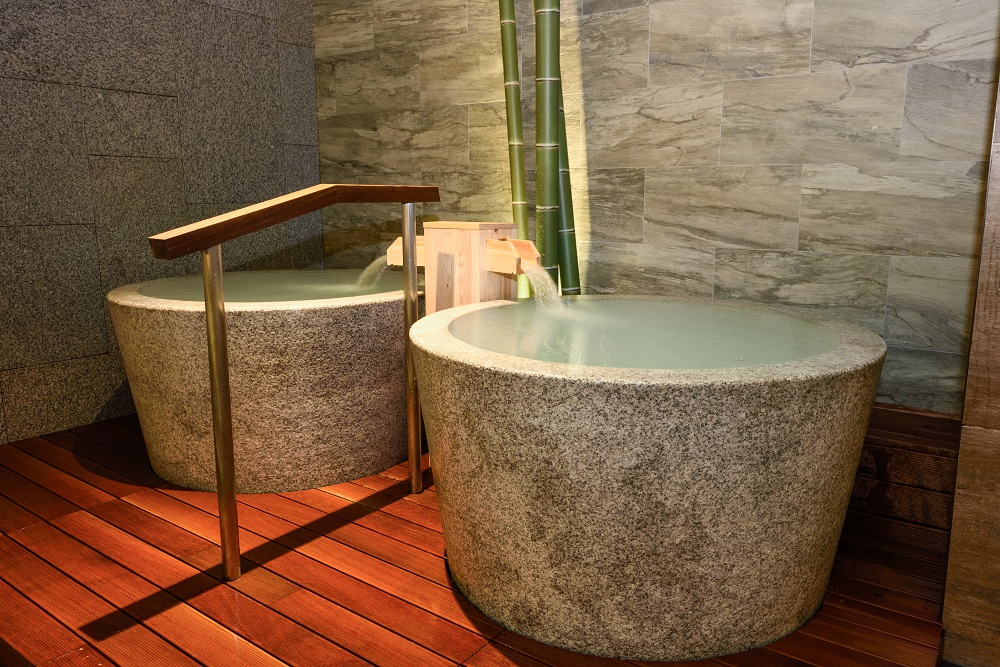<figcaption class="small mt-1"><b>항아리탕 · 실키 배스</b> 미세 거품이 뽀얗게 올라와요</figcaption></figure>
<figure class="m-0">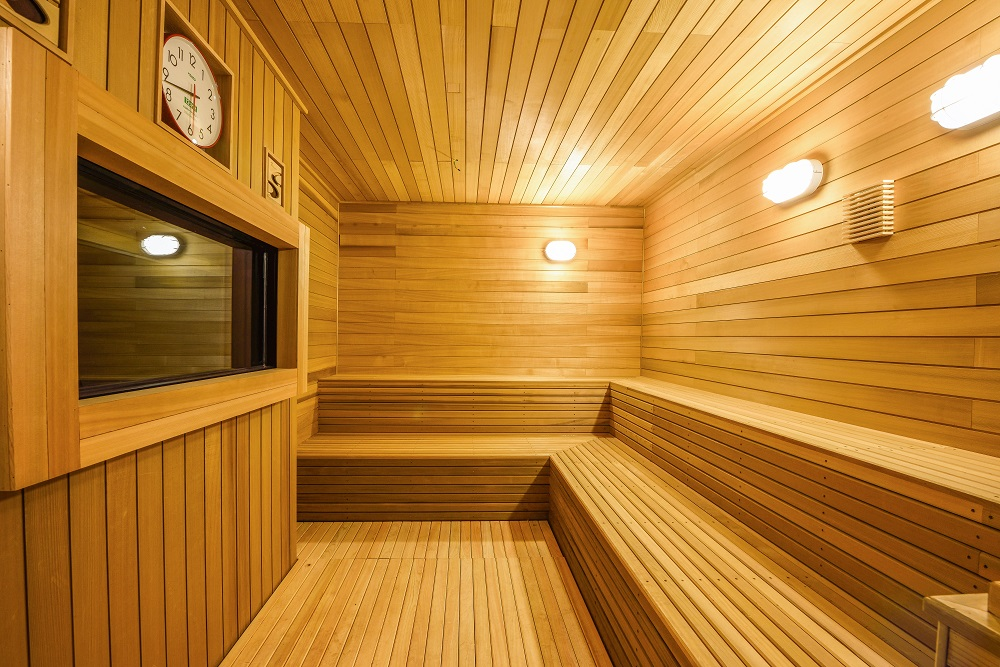<figcaption class="small mt-1"><b>고온 사우나 · 냉탕</b> TV 있음 · 01~05시는 사우나 멈춤</figcaption></figure>
<figure class="m-0">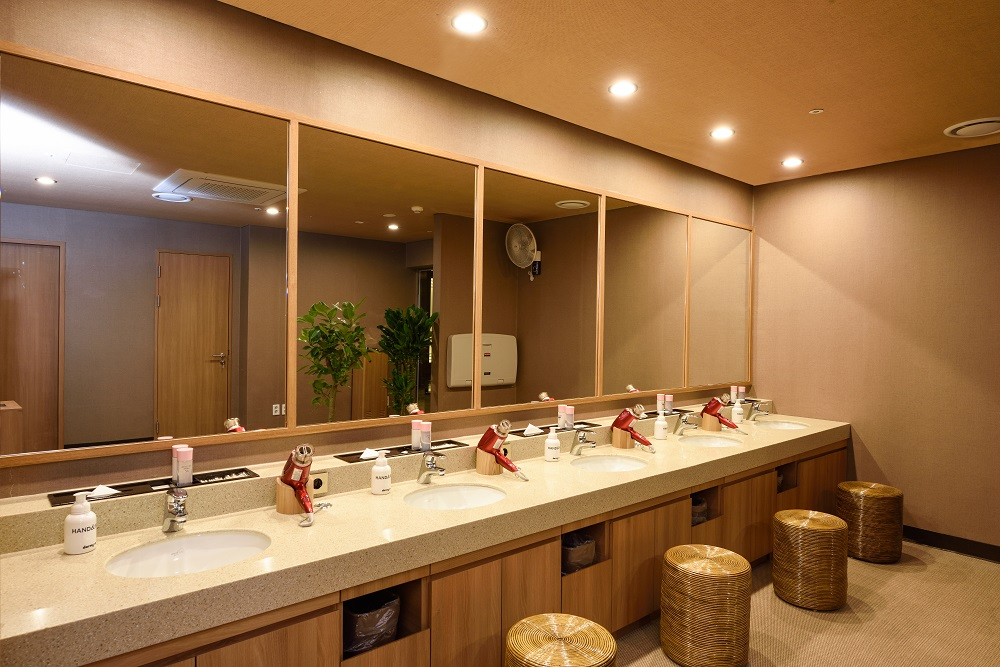<figcaption class="small mt-1"><b>파우더룸</b> 드라이어 · 세면대 · 탈의 로커</figcaption></figure>
</Grid>

<Grid cols="3" gap="12" class="mt-4">
<Tile kind="soft" color="ok" tag="🕒 운영" title="15:00 ~ 다음 날 10:00">투숙객 무료 · 밤 21:00, 아침 07:00에 가요</Tile>
<Tile kind="soft" color="warn" tag="🧺 수건" title="탈의실에 수건이 없어요">객실 수건을 들고 내려가요. 교환은 프런트</Tile>
<Tile kind="soft" color="warn" tag="📵 규칙" title="휴대폰 · 카메라 반입 금지">탕에 수건 담그지 않기 · 문신은 원칙적으로 입장 불가</Tile>
</Grid>

<Core color="ai">남탕과 여탕이 나뉘어 있어요. 21:50에 식당 앞에서 만나기로 하고 들어가면 야식 시간에 맞아요.</Core>

사진 도미인 공식 홈페이지 · 물을 마시는 것은 괜찮고 음식 · 술은 반입 금지

---
layout: magazine
class: tight
---

# 03 · 야식 — 요나키소바

도미인의 명물. 목욕 뒤에 먹는 <b>담백한 간장 라멘 한 그릇</b>이 투숙객에게 무료예요.

<Chip color="ai">장소</Chip> 로비층 레스토랑 Hatago · <Chip kind="fill">문의</Chip> 프런트 ☎ 02-548-5489

<Tile kind="fill" color="yellow" tag="🍜 한 그릇" title="닭 · 돼지 육수에 김 · 달걀 · 죽순">면에는 밀 · 달걀이 들어가요</Tile>

<Grid cols="3" gap="12">
<Tile kind="soft" color="warn" tag="시간" title="21:00~22:30 · 주문 마감 22:20">21:55에 내려가요</Tile>
<Tile kind="soft" color="ok" tag="가격" title="무료">예약 없이 식당으로</Tile>
<Tile kind="soft" color="py" tag="덤" title="아이스캔디 · 유산균 음료">15~01시 · 05~10시(후기 기준)</Tile>
</Grid>

<Core class="!mt-1">저녁 양식 · 야식 라멘 · 아침 뷔페, 세 끼가 겹치지 않아요.</Core>

::right::

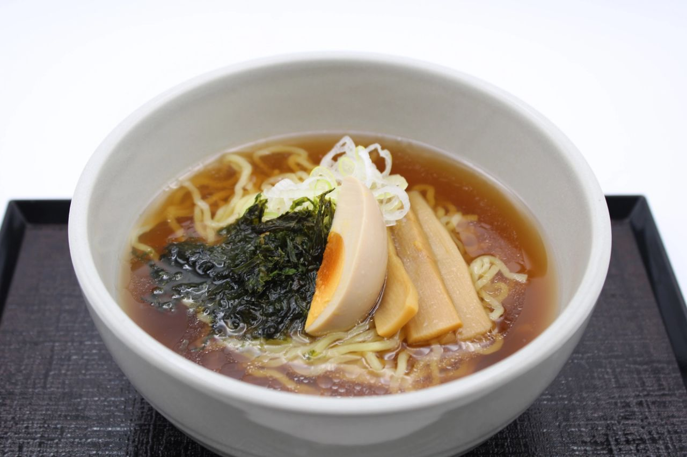

요나키소바 · 사진 도미인 공식 홈페이지

---
class: tight
---

# 04 · 조식 — **생일 아침 뷔페**

<Grid cols="4" gap="12">
<figure class="m-0">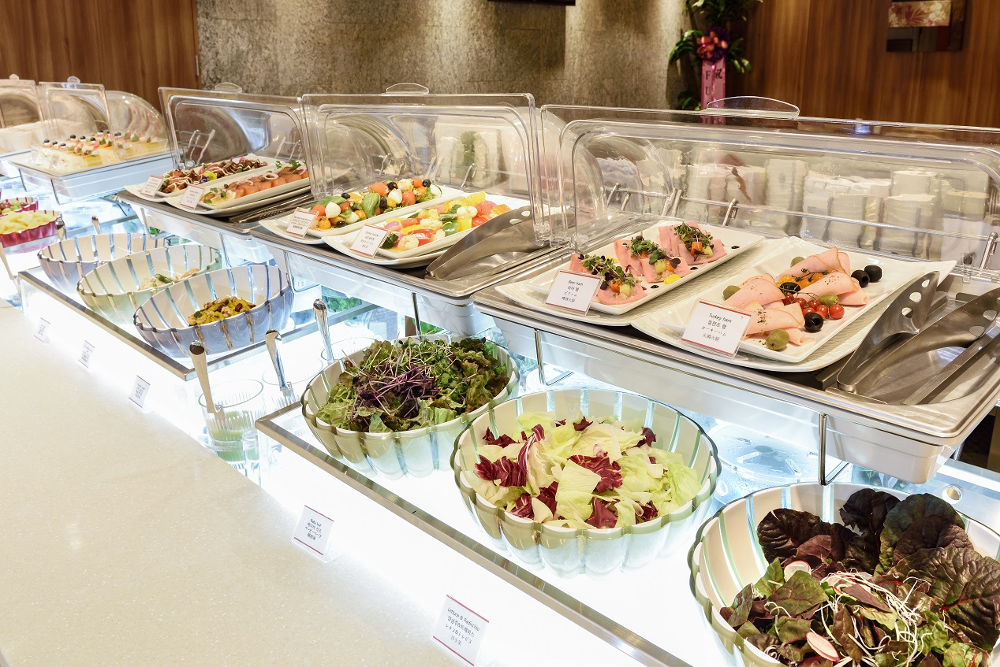<figcaption class="small mt-1"><b>샐러드 · 찬 요리</b> 가볍게 시작하기 좋아요</figcaption></figure>
<figure class="m-0">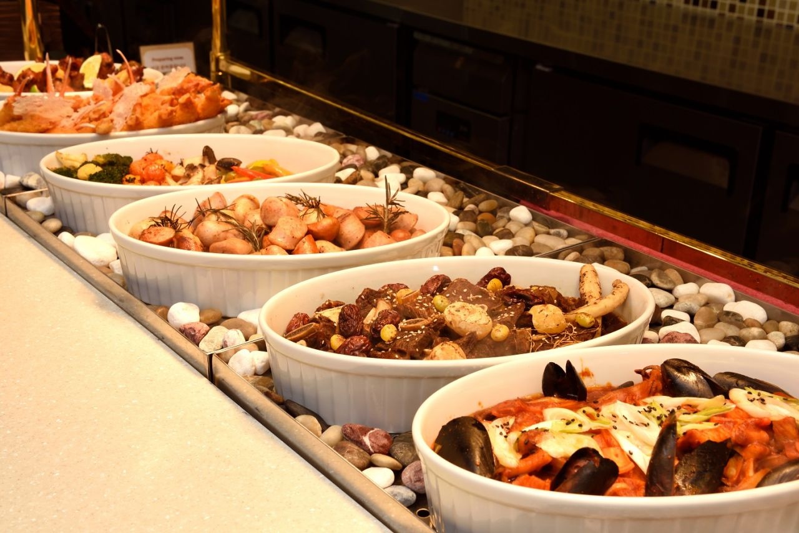<figcaption class="small mt-1"><b>따뜻한 요리</b> 한 · 중 · 일 · 양식이 섞여 있어요</figcaption></figure>
<figure class="m-0">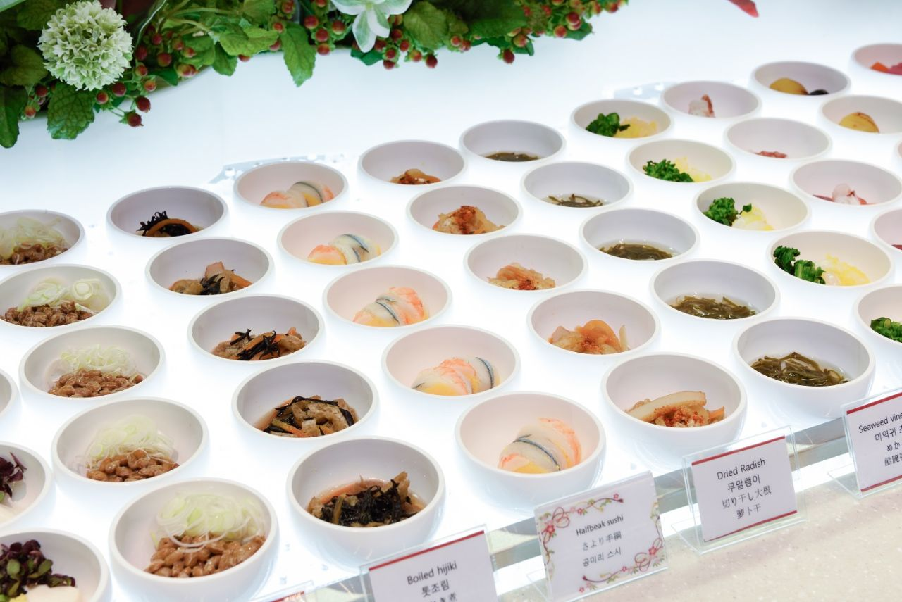<figcaption class="small mt-1"><b>작은 그릇 반찬</b> 조금씩 여러 가지를 맛봐요</figcaption></figure>
<figure class="m-0">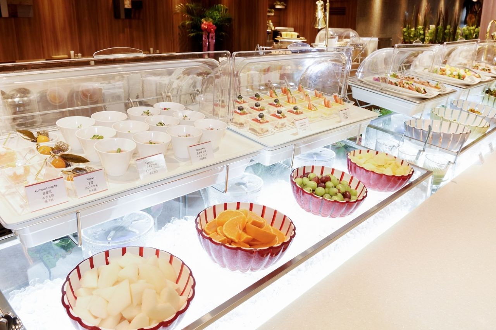<figcaption class="small mt-1"><b>과일 · 디저트</b> 마무리는 달콤하게</figcaption></figure>
</Grid>

<Grid cols="3" gap="12" class="mt-4">
<Tile kind="soft" color="ok" tag="🍽️ 구성" title="약 100가지 · 즉석 조리 코너">로비층 레스토랑 Hatago · 투숙객 전용</Tile>
<Tile kind="soft" color="warn" tag="🕒 시간" title="07:00~09:30 입장 · 10:00 종료">07:40에 가서 45분 먹어요</Tile>
<Tile kind="soft" color="py" tag="🎟️ 이용" title="예약에 포함">조식 포함 플랜이라 그냥 가면 돼요</Tile>
</Grid>

<Core color="ai">07:00에 목욕하고 관내복 그대로 내려와요. 우쭈쭈님은 더 천천히 먹어도 돼요.</Core>

사진 도미인 공식 홈페이지 · 뷔페라 알레르기 재료를 따로 빼 주지는 않아요

---
layout: cover
mesh: none
hideInToc: true
eyebrow: " "
---

HAPPY BIRTHDAY · MERRY CHRISTMAS · 12.15 – 12.16

<h1>먹고, 담그고, <strong>푹 자는</strong> 생일 전야</h1>

분위기 좋은 저녁 한 끼 · 온천욕 뒤 라멘 한 그릇 · 생일 아침은 목욕과 뷔페, 우쭈쭈님은 12시까지 느긋하게

📞 예약 · 연락처

<ul>
<li><b>저녁 12/15 19:15 · 2명</b> A 핫이슈 0507-1347-9617</li>
<li><b>도미인 서울 강남</b> 02-548-5489</li>
<li><b>B 브리비트</b> 0507-1351-9197 · <b>C 녘</b> 0507-1317-6148</li>
</ul>

🎒 챙길 것

<ul>
<li>따뜻한 겉옷 · 장갑 · 목도리 (정류장에서 8분 걸어요)</li>
<li>교통카드 · 출근용 옷 · 스킨케어</li>
<li>2~3일 전 날씨 다시 보기</li>
</ul>

<b>1</b>박<b>3</b>끼<b>2</b>번의 온천욕<b>3</b>곳의 저녁 후보<b>∞</b> 여유

